
<a href="https://github.com/2207juan/EVA/blob/main/docs/es/README.md">Español</a> &nbsp; · &nbsp; <a href="https://github.com/2207juan/EVA/blob/main/docs/en/README.md">English</a>

<a href="https://drive.google.com/drive/folders/1uZRp9SGSDykXUKvbprnLntPWDCimsDnt?usp=sharing"><b>↓ Download ISO</b></a> &nbsp; · &nbsp; <a href="https://github.com/2207juan/EVA/blob/main/docs/en/compatibility.md">Your PC</a> &nbsp; · &nbsp; <a href="https://github.com/2207juan/EVA/blob/main/docs/en/installation.md">Install</a> &nbsp; · &nbsp; <a href="https://github.com/2207juan/EVA/blob/main/docs/en/shortcuts.md">Shortcuts</a> &nbsp; · &nbsp; <a href="https://webdesing-40d1a.web.app/">Web</a>

https://github.com/user-attachments/assets/66bce099-2a7d-4ea7-a75f-3814e7d73b33

<h3 align="center">Desktop tour</h3>

https://github.com/user-attachments/assets/f1e487e2-4d09-4ad7-be5e-f2fbfe0973a5

<h3 align="center">Desktop</h3>

<table>
<tr>
<td width="50%">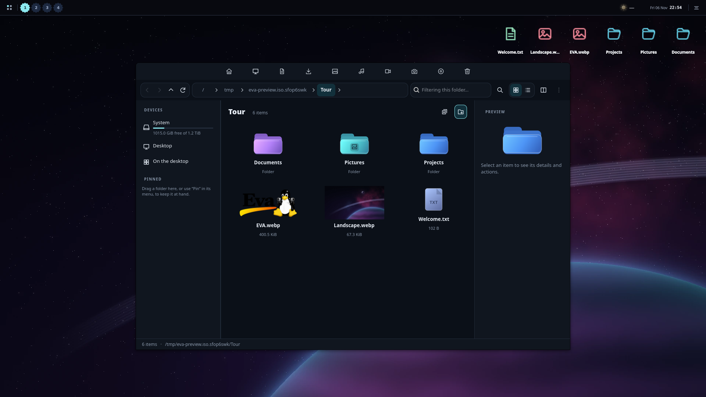 Prisma</td>
<td width="50%">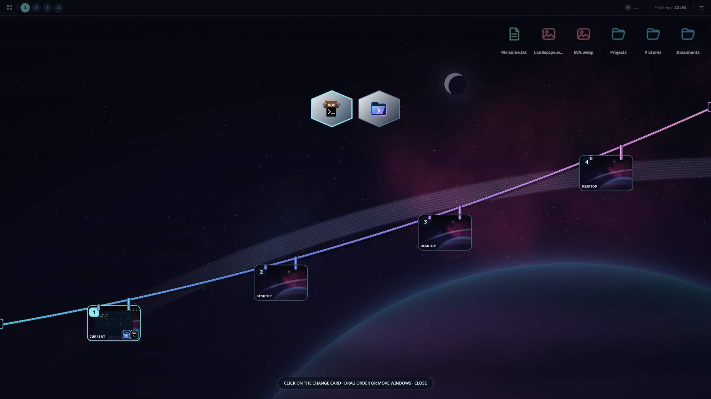 Window overview</td>
</tr>
<tr>
<td width="50%">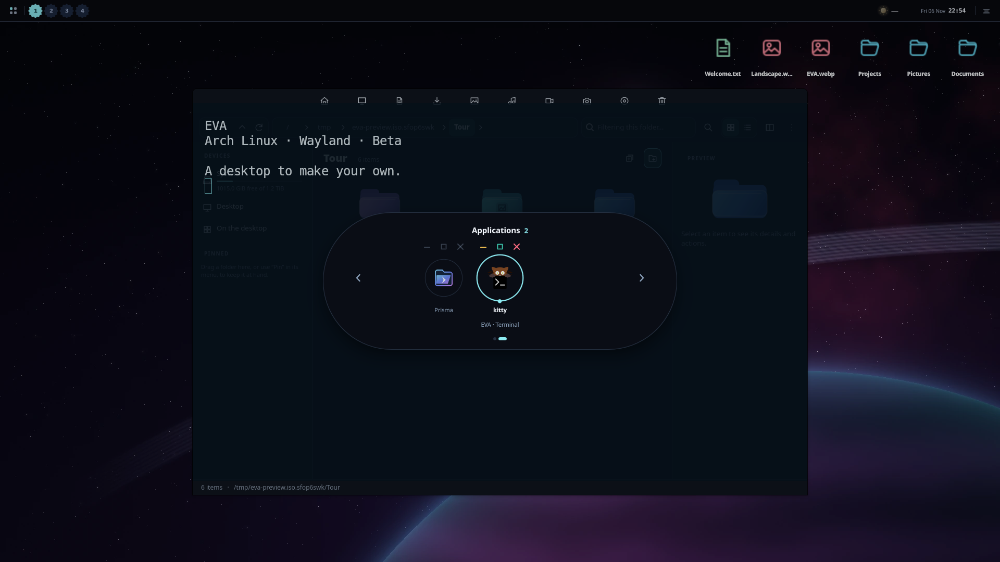 Open applications</td>
<td width="50%">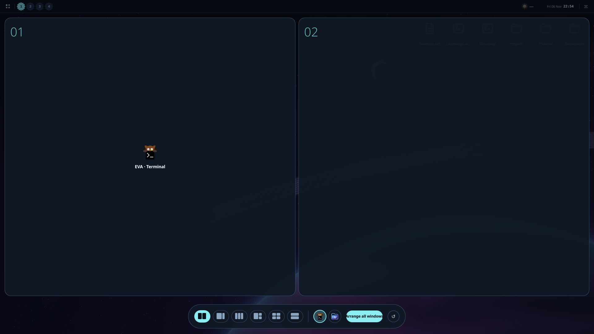 Snap</td>
</tr>
</table>

<h3 align="center">Settings</h3>

<table>
<tr>
<td width="50%">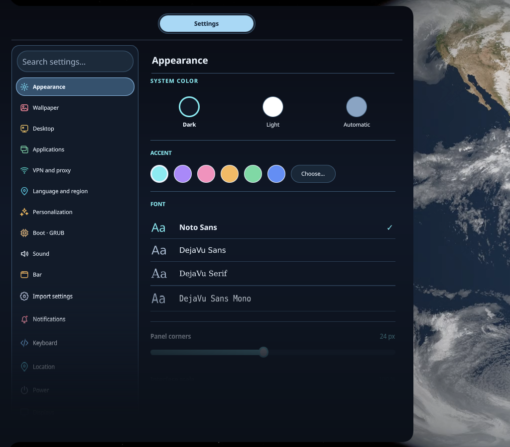 Appearance</td>
<td width="50%">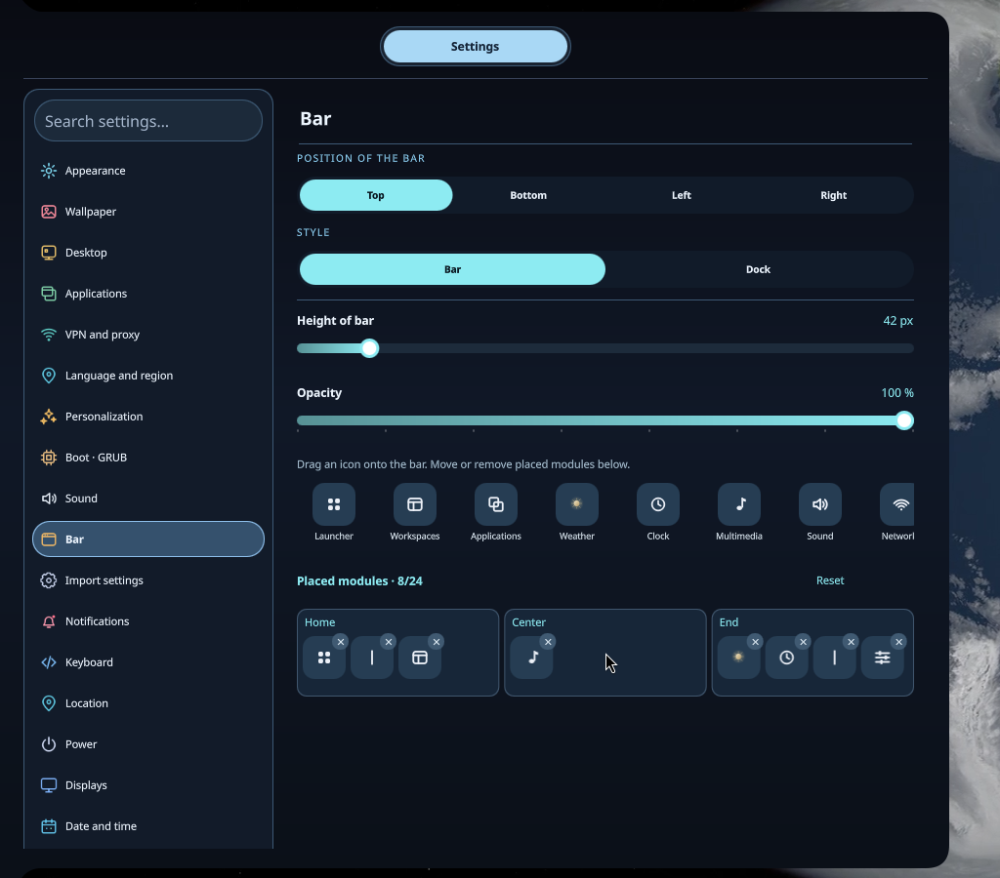 Bar</td>
</tr>
<tr>
<td width="50%">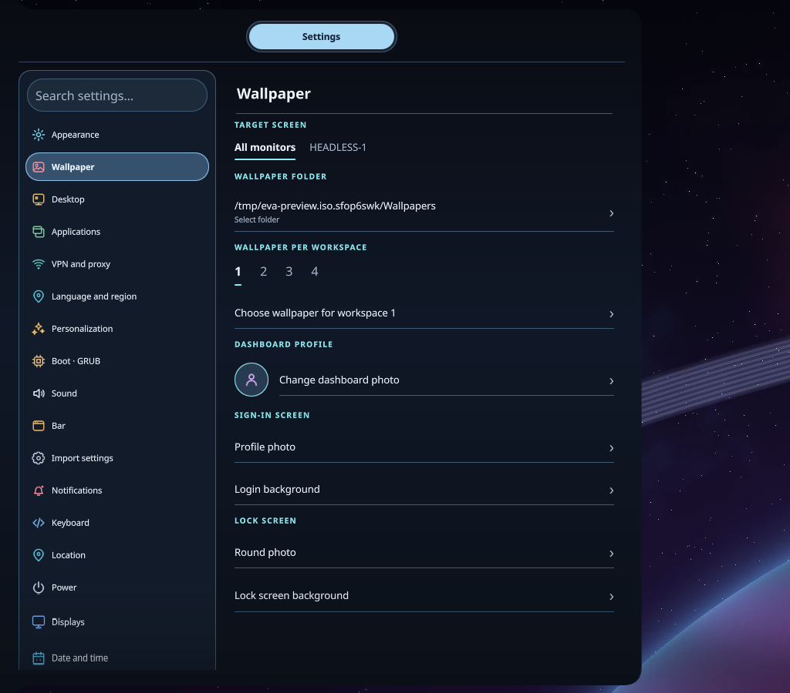 Wallpapers</td>
<td width="50%">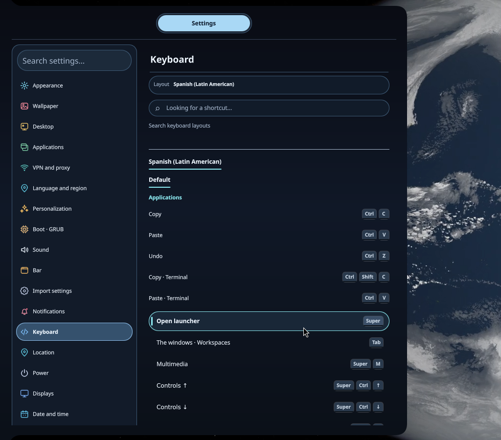 Keyboard</td>
</tr>
</table>

<h3 align="center">Games</h3>

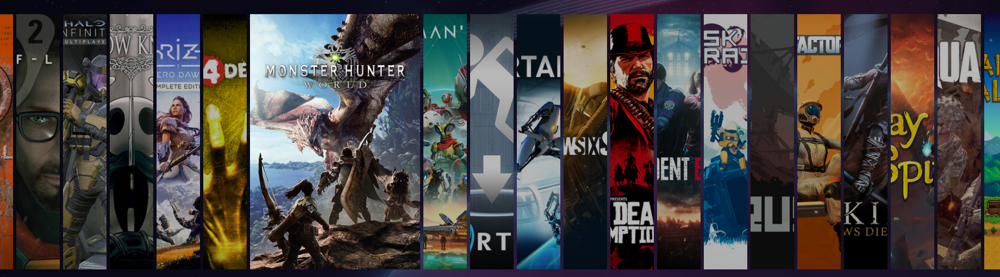

<h3 align="center">Widgets & pets</h3>

<table>
<tr>
<td width="50%">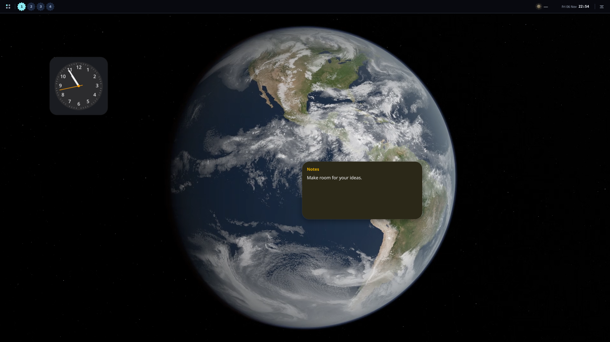 Widgets</td>
<td width="50%">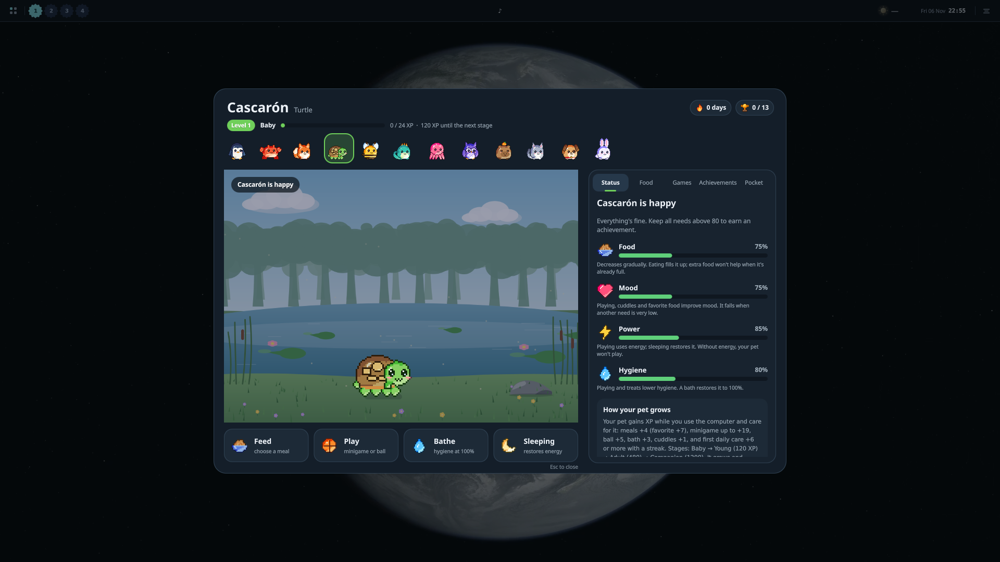 Pets</td>
</tr>
</table>
