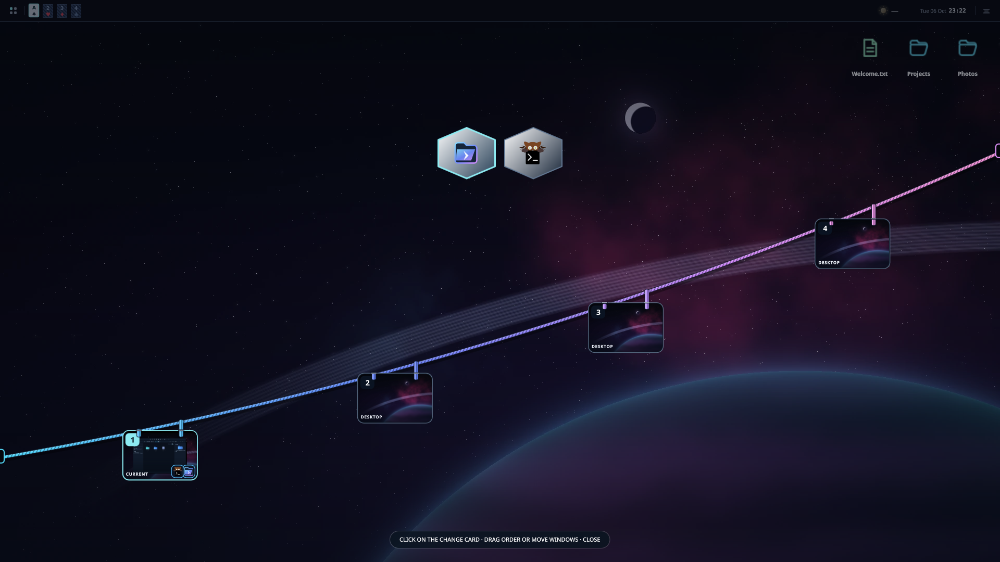

<p align="center"><a href="README.md">English</a> · <a href="README.es.md">Español</a></p>


**Eva es un sistema basado en Arch Linux con su propio escritorio Wayland.** **Beta · Fase 1.**

> Eva es un proyecto en beta y puede contener errores. ¡[Reportar un problema](https://github.com/2207juan/EVA/issues/new/choose) nos ayuda muchísimo a mejorar Eva y hacer crecer el proyecto!

https://github.com/user-attachments/assets/0784ac2a-7fd6-427a-851f-a188beb754e6

<p align="center">
<a href="https://github.com/2207juan/EVA/releases/tag/v0.1.0-phase1"></a>
<a href="#vistas-previas"></a>
<a href="https://github.com/2207juan/EVA/issues"></a>
<a href="https://www.instagram.com/eva.frik"></a>
</p>

## Vistas previas

Las funciones de estas imágenes forman parte de Eva y se instalan juntas con la ISO. **Descargar ISO** abre los archivos de la versión; **Vistas previas** lleva a esta galería; **Seguinos** abre Instagram; **Informar de un problema** abre Issues de GitHub.


| Modo negro | Clima |
| :-- | :-- |
|  |  |
| **Dock** | **Lanzador · diseño 2** |
|  |  |
| **Game Center** | **Monitor del sistema** |
|  |  |
| **Mascota animada** | **Hábitat de mascotas** |
|  |  |


| Archivos y carpetas en el escritorio | Explorador Prisma |
| :-- | :-- |
|  |  |
| **Selector de fondos** | **Controles multimedia** |
|  |  |
| **Ajustes de audio** | **Indicador de volumen** |
|  |  |

<details>
<summary>Burbujas y vista de espacios</summary>


</details>

Las capturas muestran la interfaz real de Eva en inglés, con Glass desactivado y un perfil de demostración separado. El clima usa Nueva York y Game Center muestra una biblioteca de ejemplo. Los juegos no están incluidos. La vista de audio usa dispositivos virtuales reales en una sesión separada.

## Vista TAB

Cambia entre tus aplicaciones y espacios de trabajo. La captura muestra Prisma y una terminal real.



## Qué incluye

- Apariencia oscura, clara y Liquid Glass; barra, dock, widgets y espacios personalizables.
- Game Center, explorador Prisma, capturas de pantalla y grabación de video.
- Mascotas animadas con conversación opcional mediante IA. Necesitas tu propia clave API; la disponibilidad depende del proveedor.
- Instalador Calamares y menú de arranque personalizado.

## Animaciones

Animaciones nativas al abrir y cerrar **Prisma**, con ventanas reales de la aplicación.

| Glitch RGB | Lámpara |
| :-- | :-- |
|  |  |


<details>
<summary>Reproducir los videos de las animaciones</summary>

**Glitch RGB · apertura de Prisma**

https://github.com/user-attachments/assets/c9a0be91-fbf7-4670-ac9b-d6a901fe1269

**Lámpara · cierre de Prisma**

https://github.com/user-attachments/assets/3f3e1602-7770-4390-9e48-c558f5cd5bcc

</details>

<a id="descarga"></a>

## Descarga e instalación

**[Abrir la descarga de la fase 1](https://github.com/2207juan/EVA/releases/tag/v0.1.0-phase1).** x86_64 · BIOS / UEFI.

1. Descarga estos **cuatro archivos** en la misma carpeta:

   - [Eva-2026.10.06-x86_64.iso.part-001](https://github.com/2207juan/EVA/releases/download/v0.1.0-phase1/Eva-2026.10.06-x86_64.iso.part-001)
   - [Eva-2026.10.06-x86_64.iso.part-002](https://github.com/2207juan/EVA/releases/download/v0.1.0-phase1/Eva-2026.10.06-x86_64.iso.part-002)
   - [release.json](https://github.com/2207juan/EVA/releases/download/v0.1.0-phase1/release.json)
   - [reconstruir.py](https://github.com/2207juan/EVA/releases/download/v0.1.0-phase1/reconstruir.py)

2. Instala [Python 3](https://www.python.org/downloads/) si hace falta. Abre una terminal en esa carpeta y ejecuta:

   ```sh
   python3 reconstruir.py --join release.json
   ```

   En Windows, usa `python` en lugar de `python3`. El script verifica las partes y crea `Eva-2026.10.06-x86_64.iso`. **Es una sola ISO dividida en dos descargas.**

3. Prepara un pendrive de **8 GB o más** con [Ventoy](https://www.ventoy.net/en/doc_start.html) y copia dentro la `.iso` reconstruida. Preparar el USB borra su contenido. En Windows también puedes grabar la ISO con [Rufus](https://rufus.ie/es/).
4. Reinicia el equipo, elige el USB en su menú de arranque y selecciona Eva. Puedes probar el escritorio antes de instalar.
5. Abre el instalador de Eva (Calamares). Elige idioma, teclado, disco de instalación y usuario; revisa el resumen antes de confirmar. Haz una copia de tus archivos: borrar un disco elimina su contenido.
6. Al terminar, reinicia y retira el pendrive.

Game Center, Prisma, el dock, los widgets y las mascotas vienen incluidos. Los juegos y las claves API opcionales para IA se agregan aparte. Los archivos **Source code (zip/tar.gz)** de GitHub contienen la presentación, no la imagen de instalación.

> La fase 1 es una versión de pruebas. Haz una copia de tus archivos antes de instalar. Puedes informar de errores indicando tu equipo, cómo reproducirlos y una captura sin datos personales.

## Actualizaciones

Eva guarda los ajustes personales en tu perfil de usuario. Las actualizaciones del paquete de Eva crean copias locales para recuperarlos antes de actualizar. Reinstalar o formatear una partición es una operación distinta; conserva una copia de tus archivos.

[Informar de un problema](https://github.com/2207juan/EVA/issues) · [Seguinos en redes sociales](https://www.instagram.com/eva.frik)
