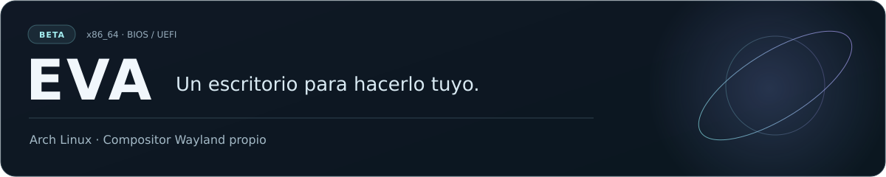
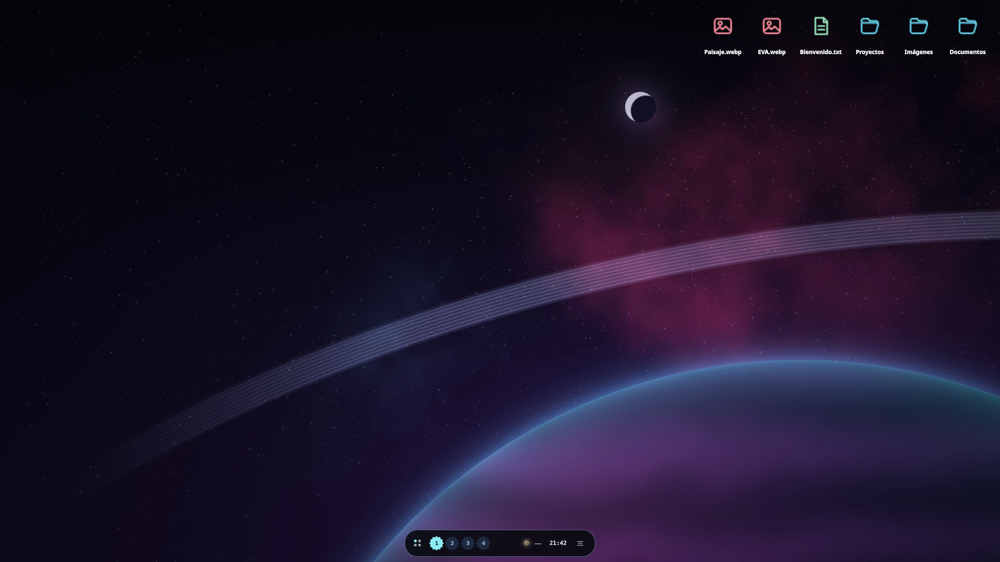
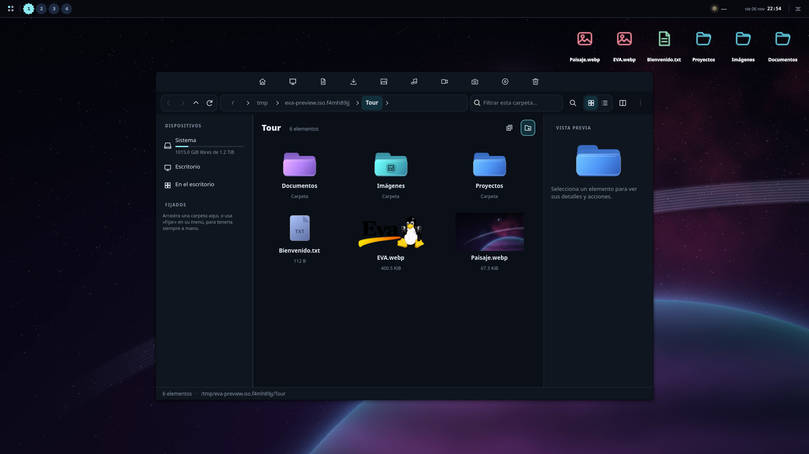
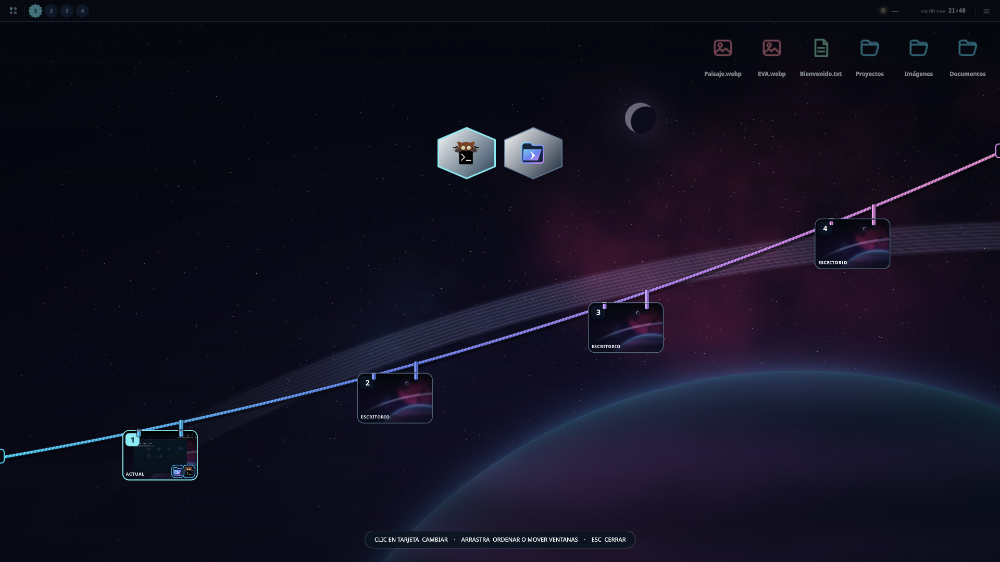
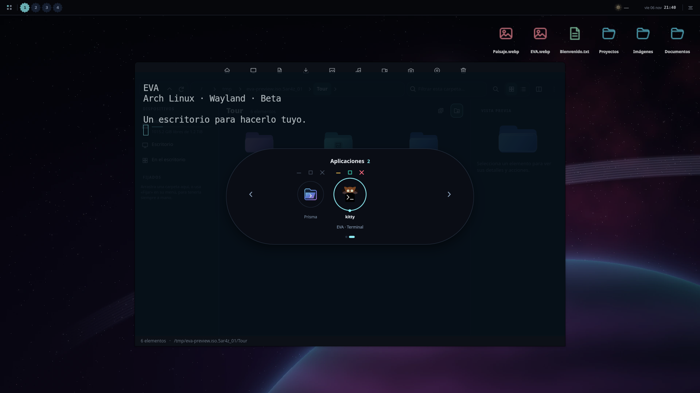
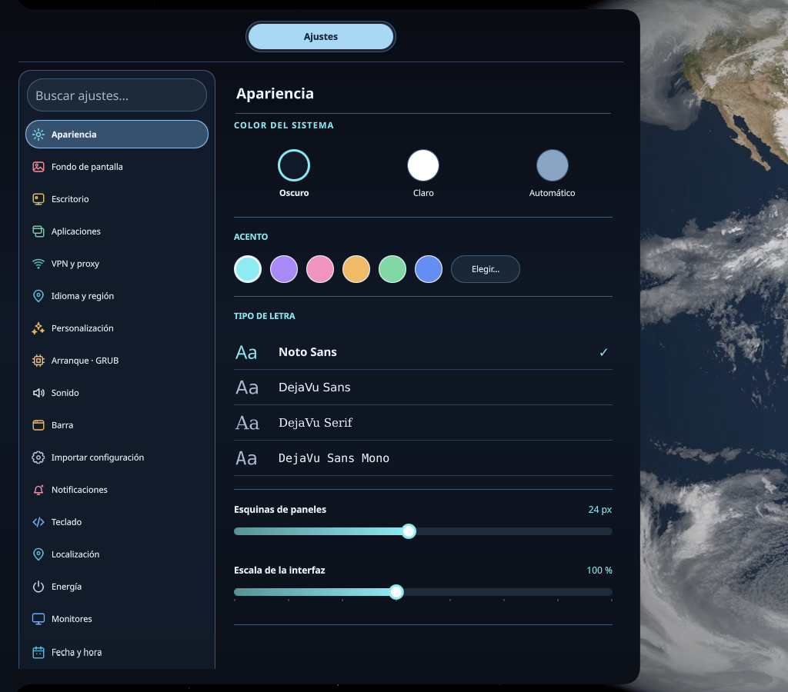
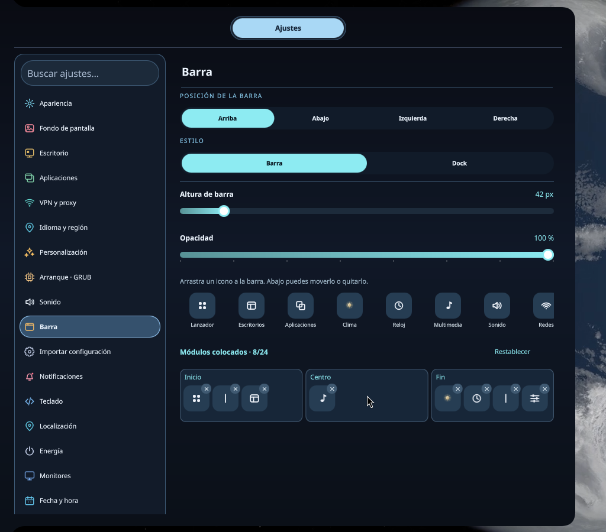
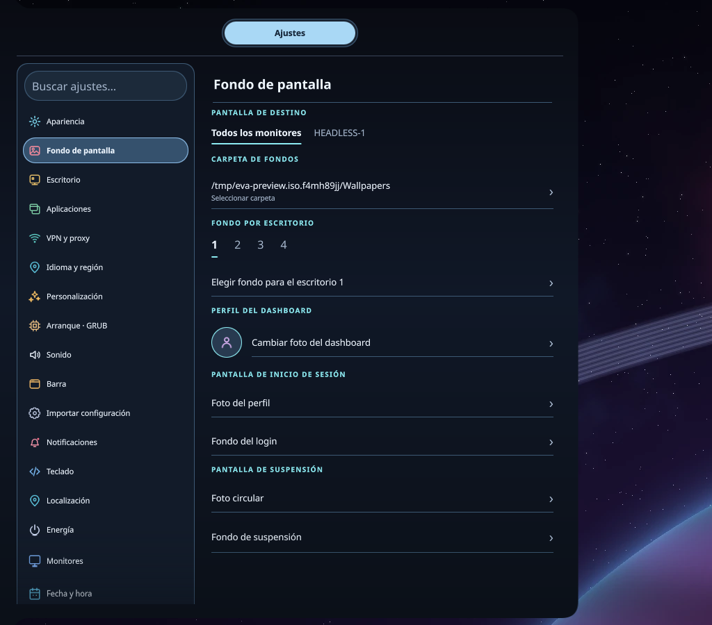
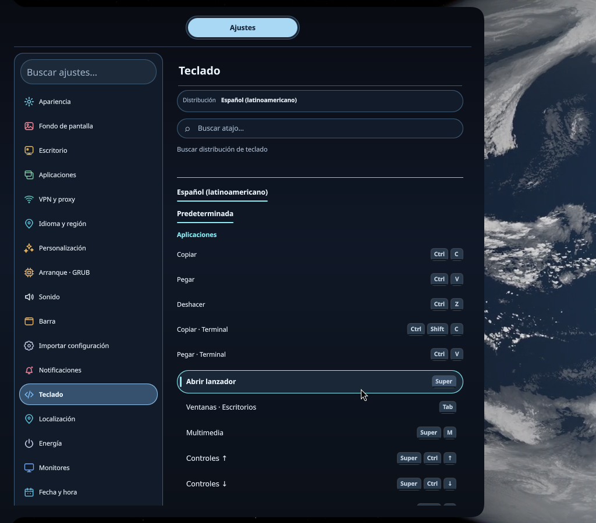

<a href="README.md">English</a> · <b>Español</b>

https://github.com/user-attachments/assets/66bce099-2a7d-4ea7-a75f-3814e7d73b33

<b>Recorrido actual del escritorio · 3:29 · sin cortes</b>

https://github.com/user-attachments/assets/08e6ad41-72d6-49a1-9e5c-6924a9172992

Voz y escritorio en español · subtítulos en español.

EVA es una distribución basada en **Arch Linux**, con escritorio y compositor **Wayland propios**. Combina organización de ventanas, personalización y herramientas cotidianas en una interfaz común.

**Está en beta.** La imagen disponible es para **x86_64**, con arranque BIOS/UEFI e instalación gráfica. Las capturas y los recorridos muestran el desarrollo actual; la ISO del enlace puede corresponder a una compilación anterior.

## El escritorio

Lanzador con búsqueda de aplicaciones y archivos, escritorios virtuales, ventanas en mosaico o flotantes y **Prisma**, el explorador de EVA. La estantería reúne las aplicaciones abiertas sin duplicar sus iconos en el dock.

<table>
<tr>
<td width="50%"> Escritorio y dock</td>
<td width="50%"> Prisma · archivos y carpetas</td>
</tr>
<tr>
<td width="50%"> Tab · vista general</td>
<td width="50%"> Super+B · aplicaciones abiertas</td>
</tr>
</table>

## Hazlo tuyo

Modo claro u oscuro, colores, fondos por escritorio y monitor, barra con módulos que puedes arrastrar y atajos editables. La interfaz adapta las opciones disponibles al hardware del equipo.

<table>
<tr>
<td width="50%"> Apariencia · colores y efectos</td>
<td width="50%"> Barra · módulos y distribución</td>
</tr>
<tr>
<td width="50%"> Fondos · escritorios y monitores</td>
<td width="50%"> Teclado · distribución y atajos</td>
</tr>
</table>

También incluye capturas, grabación, OCR local, controles multimedia, widgets y mascotas. La isla de IA admite proveedores compatibles y agentes de desarrollo; las funciones en línea requieren tu propio servicio.

## Empieza por aquí

| Acción | Atajo predeterminado |
| :-- | :-- |
| Lanzador | `Super` |
| Vista general | `Tab` |
| Aplicaciones abiertas | `Super+B` |
| Organizar ventanas | `Super+Z` |
| Prisma / fondos | `Super+P` / `Super+W` |
| Captura / grabación | `Super+F` / `Super+G` |
| EVA IA | `Super+I` |

Super es la tecla Windows. Los atajos se pueden cambiar en **Ajustes → Teclado**.

Para probar EVA, descarga la ISO, cópiala a un USB con Ventoy y arranca desde él. Desde la sesión Live puedes abrir el instalador gráfico. Después, cambia el tema de arranque desde **Ajustes → Arranque · GRUB**.

Recorridos continuos de una sesión de prueba de EVA, con archivos de demostración y narración sintética local. No muestran una instalación física ni pruebas de rendimiento. Conserva una copia de tus archivos antes de instalar.
