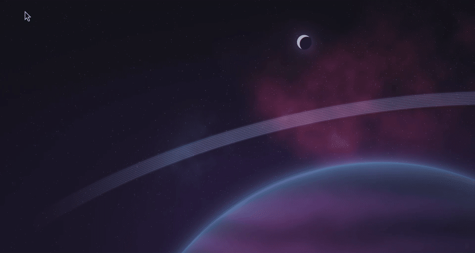
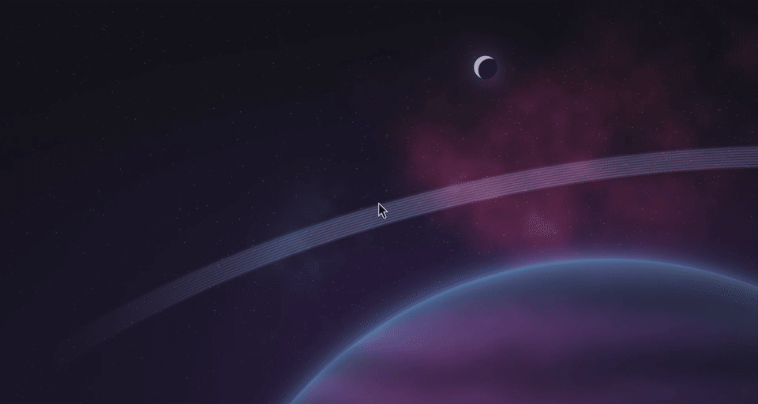
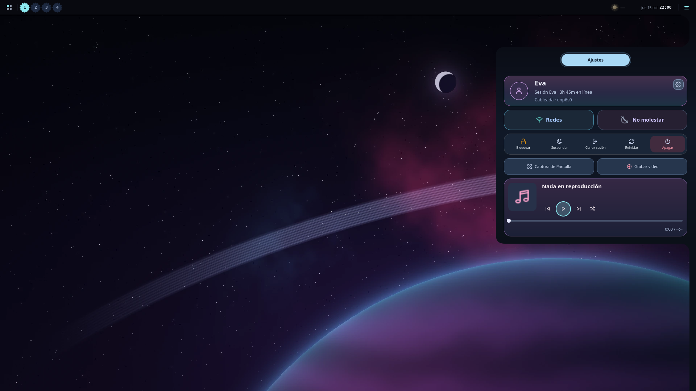
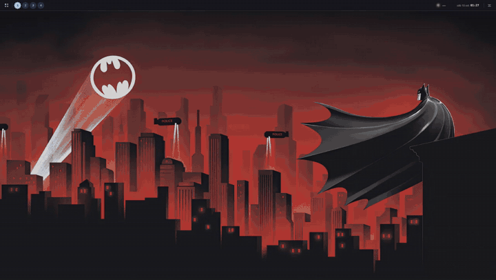
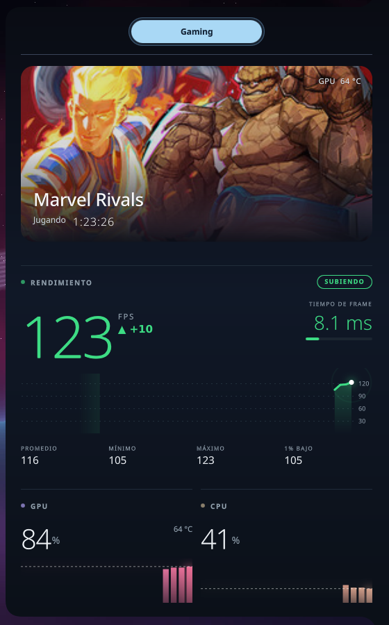

<a href="README.md">English</a> · <a href="README.es.md">Español</a>

**Una distribución basada en Arch Linux con su propio compositor Wayland.**

Versión 1.0 · Beta · [V4 · 2026-10-16](CHANGELOG.md). Puede contener errores. [Ayuda a Eva a crecer reportándolos.](https://github.com/2207juan/EVA/issues/new/choose)

<video src="https://github.com/user-attachments/assets/66bce099-2a7d-4ea7-a75f-3814e7d73b33" controls width="960"></video>

## Escritorio

| Dock | Lanzador |
| :-- | :-- |
|  |  |
| **Apariencia** | **Burbujas** |
|  |  |

**TAB**

## Ventanas

| Mosaico | Libres |
| :-- | :-- |
|  |  |

| Glitch RGB | Lámpara |
| :-- | :-- |
|  |  |

**Inclinación**

## Personalización

| Glitch del cursor | Estela del cursor |
| :-- | :-- |
|  |  |

[Vídeo de glitch](assets/previews/cursor-glitch.mp4) · [Vídeo de estela](assets/previews/cursor-trail.mp4) · Grabados en EVA.

| Mascotas · Super + I | Hábitat de mascotas |
| :-- | :-- |
|  |  |

## Sistema

| Prisma | Multimedia |
| :-- | :-- |
|  |  |

| Fondos de pantalla | Volumen |
| :-- | :-- |
|  |  |

## Widgets

| Clima | Monitor del sistema |
| :-- | :-- |
|  |  |
| **Biblioteca de juegos** | **Gaming · Marvel Rivals** |
|  |  |

Vista de biblioteca: 12 carátulas de Steam de ejemplo; no se instalaron ni ejecutaron juegos para esta captura. Demostración Gaming: métricas simuladas.

## Instalar

**[Descargar ISO de Eva](https://drive.google.com/drive/folders/1uZRp9SGSDykXUKvbprnLntPWDCimsDnt?usp=sharing)** · x86_64 · BIOS / UEFI

Estas vistas V4 muestran cambios pendientes de la próxima construcción de la ISO.

1. Descarga el archivo `.iso` desde Drive.
2. Cópialo a un USB con Ventoy y arranca desde él.
3. Prueba Eva y abre **Instalar Eva** para instalar.

Haz una copia de tus archivos antes de cambiar las particiones.

## GRUB

| Evacraft | Netrunner |
| :-- | :-- |
|  |  |

---

[Reportar un error](https://github.com/2207juan/EVA/issues/new/choose) · [Instagram](https://www.instagram.com/eva.frik)
