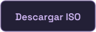
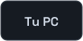
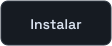
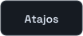
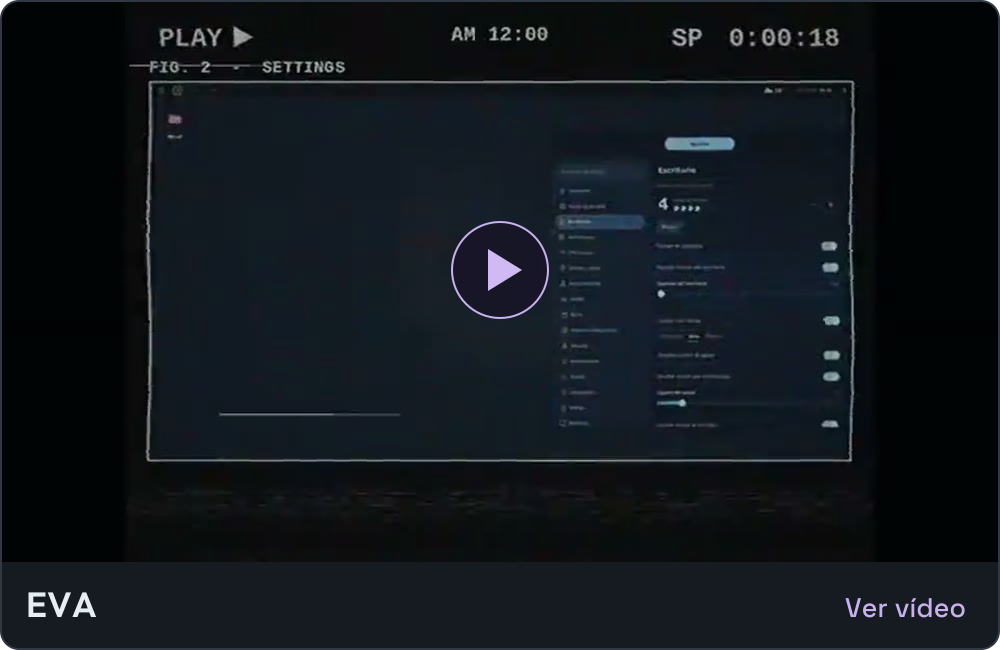
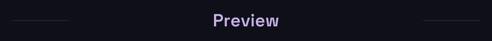
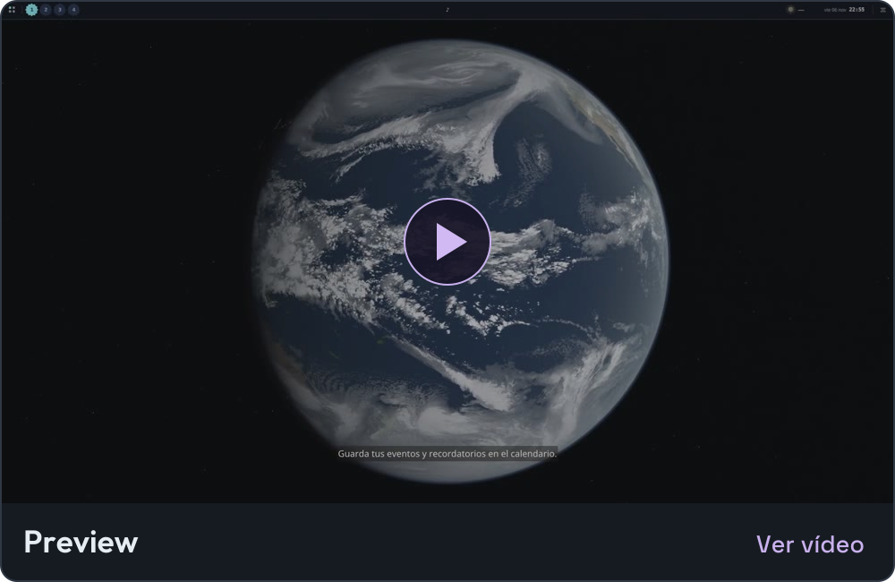
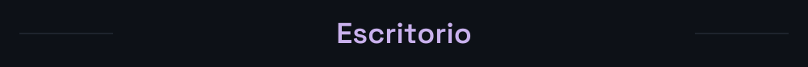
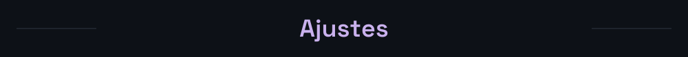
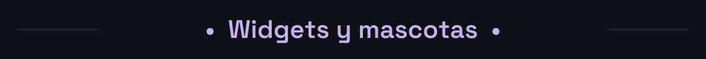

<a href="https://github.com/2207juan/EVA/blob/main/docs/es/README.md">Español</a> &nbsp; · &nbsp; <a href="https://github.com/2207juan/EVA/blob/main/docs/en/README.md">English</a>

    

<table>
<tr>
<td width="50%"> Prisma</td>
<td width="50%"> Vista general</td>
</tr>
<tr>
<td width="50%"> Aplicaciones abiertas</td>
<td width="50%"> Snap</td>
</tr>
</table>

<table>
<tr>
<td width="50%"> Apariencia</td>
<td width="50%"> Barra</td>
</tr>
<tr>
<td width="50%"> Fondos</td>
<td width="50%"> Teclado</td>
</tr>
</table>

<table>
<tr>
<td width="50%"> Widgets</td>
<td width="50%"> Mascotas</td>
</tr>
</table>
