<p align="center"><a href="README.md">English</a> · <a href="README.es.md">Español</a></p>

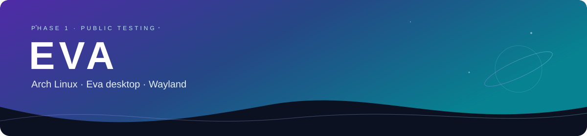

**Eva is an Arch Linux system with its own Wayland desktop.** Phase 1 is available for public testing.

https://github.com/user-attachments/assets/0784ac2a-7fd6-427a-851f-a188beb754e6

<p align="center">
<a href="https://github.com/2207juan/EVA/releases/tag/v0.1.0-phase1"></a>
<a href="#preview"></a>
<a href="https://github.com/2207juan/EVA/issues"></a>
<a href="https://www.instagram.com/eva.frik"></a>
</p>

## Preview

The features pictured here are part of Eva and install together with the ISO. **Download ISO** opens the release files; **Previews** jumps to this gallery; **Follow us** opens Instagram; **Report a bug** opens GitHub Issues.

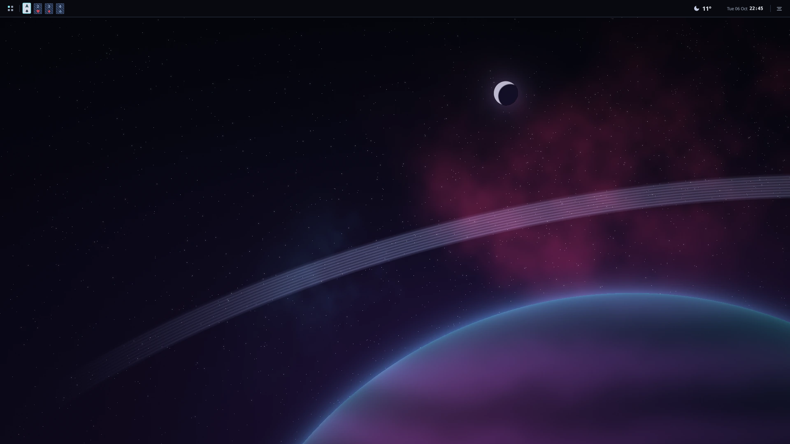

| Dark theme | Weather |
| :-- | :-- |
|  | 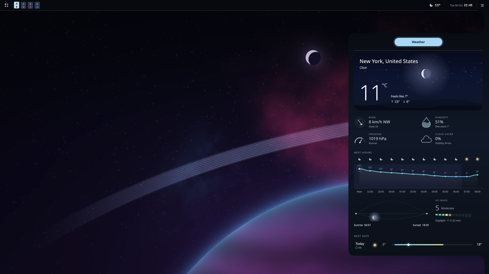 |
| **Dock** | **Launcher · design 2** |
| 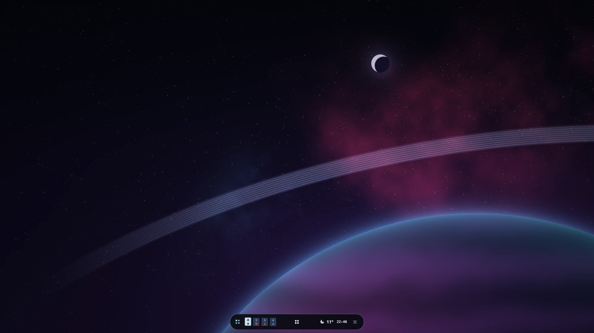 |  |
| **Game Center** | **System monitor** |
| 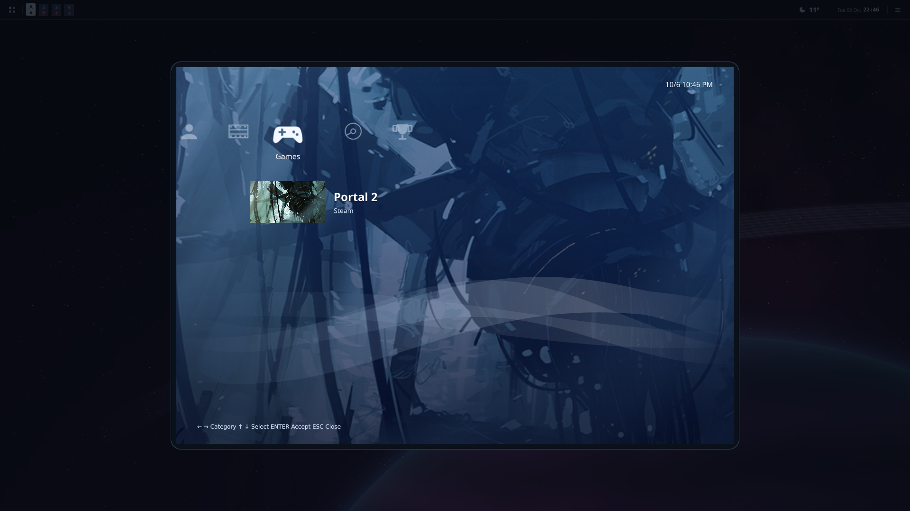 | 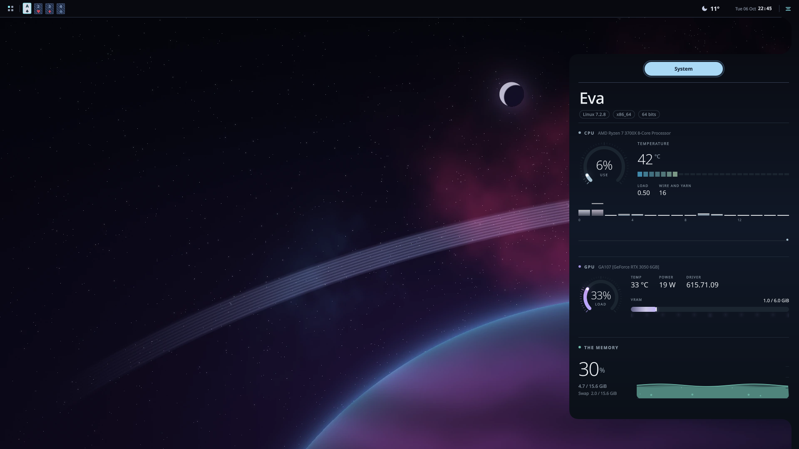 |
| **Animated companion** | **Pet habitat** |
| 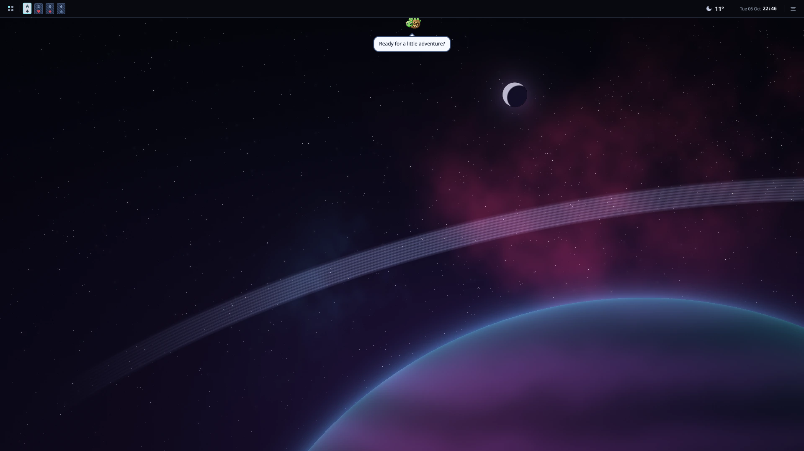 | 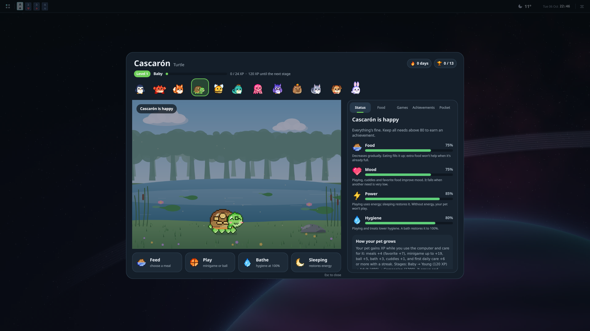 |


| Desktop files and folders | Prisma file manager |
| :-- | :-- |
|  | 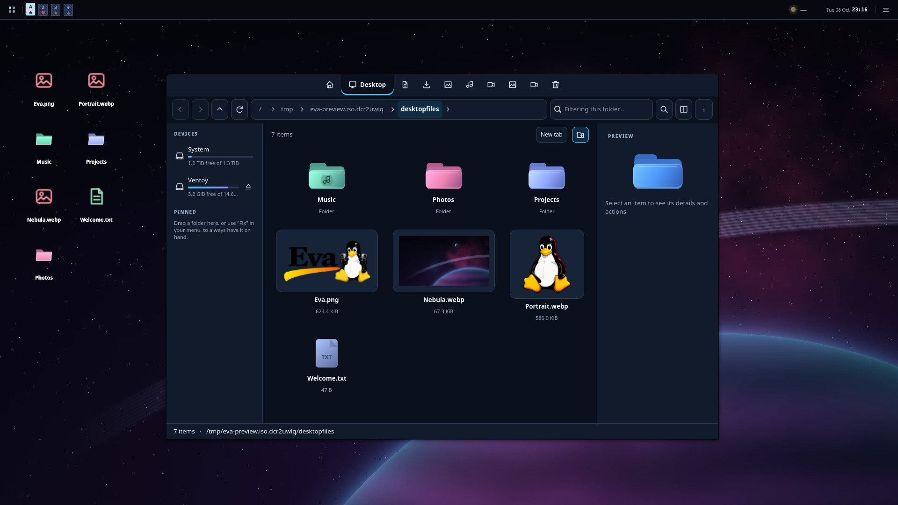 |
| **Wallpaper selector** | **Multimedia controls** |
| 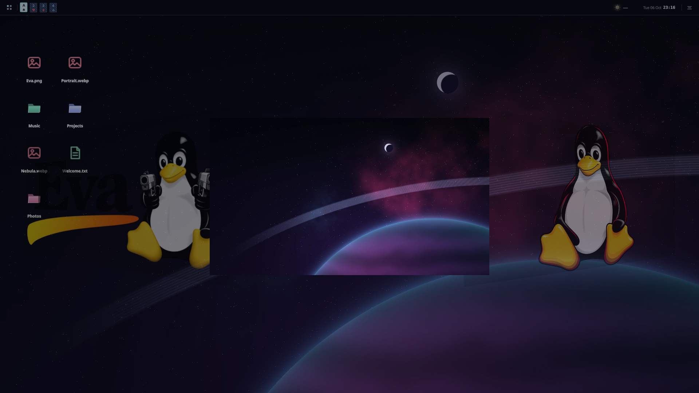 |  |
| **Audio settings** | **Volume popup** |
| 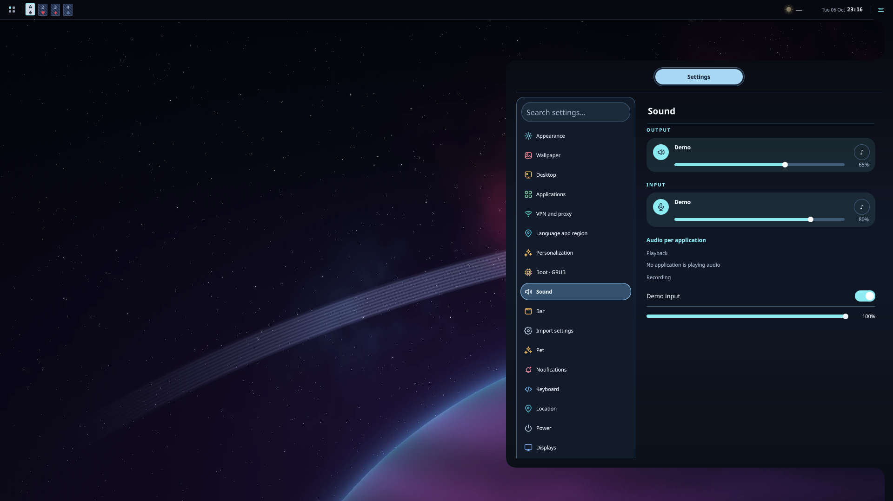 | 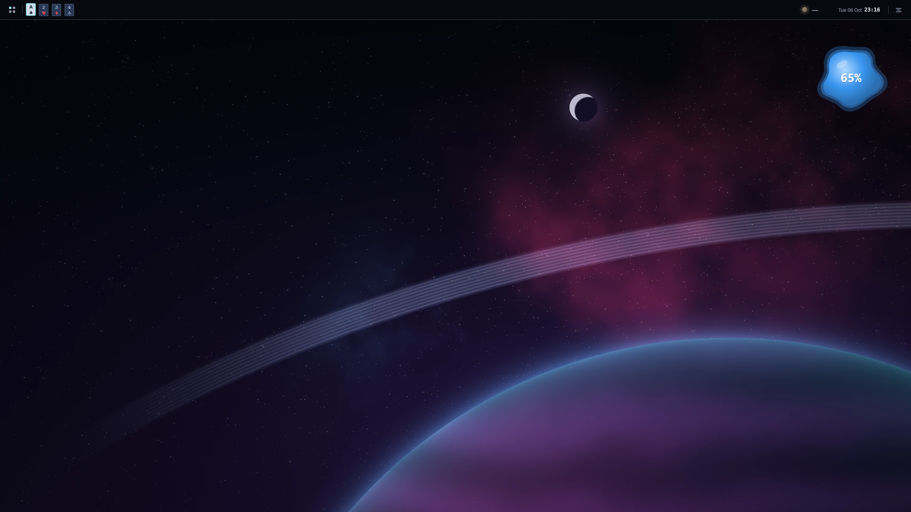 |

<details>
<summary>Bubbles and workspace overview</summary>


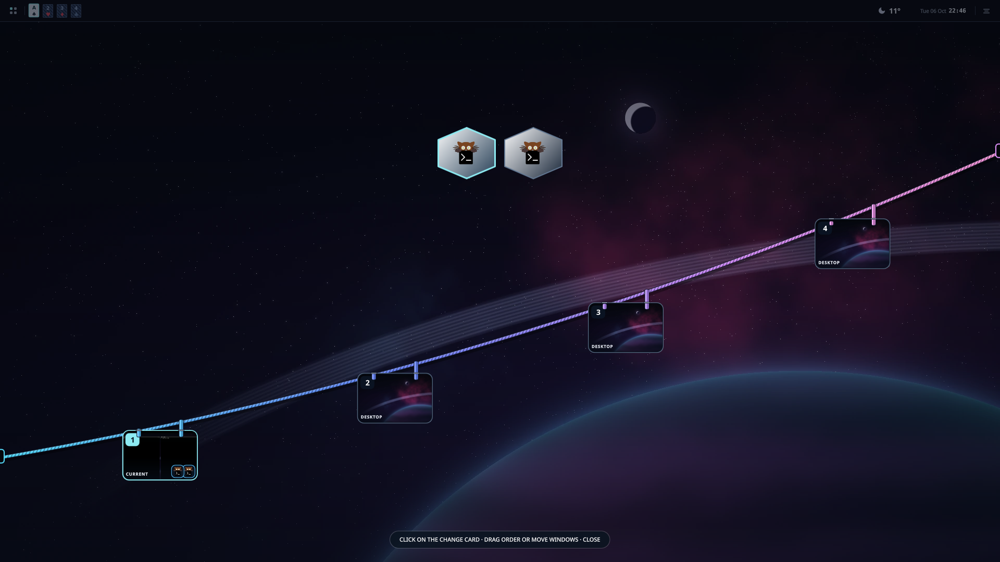

</details>

Screenshots show the actual Eva interface in English with Glass disabled, using an isolated demo profile. Weather uses New York; the Game Center shows an example library. Games are not included. The audio preview uses real, isolated virtual devices.

## Inside Eva

- Dark, light and Liquid Glass appearance; configurable bars, dock, widgets and workspaces.
- Game Center, Prisma file manager, screenshots and screen recording.
- Animated pets with optional AI conversation. Bring your own API key; availability depends on the provider.
- Calamares installer and themed boot menu.

## Motion

Native animations while opening and closing **Prisma**, with actual application windows.

| RGB glitch | Lamp |
| :-- | :-- |
| 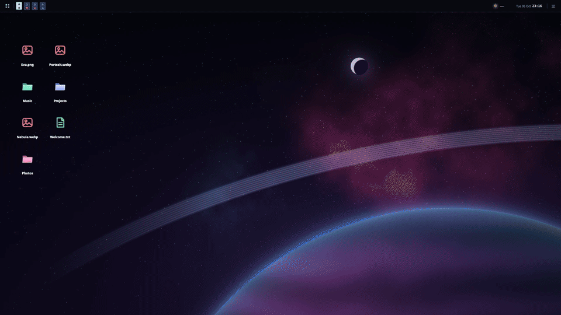 | 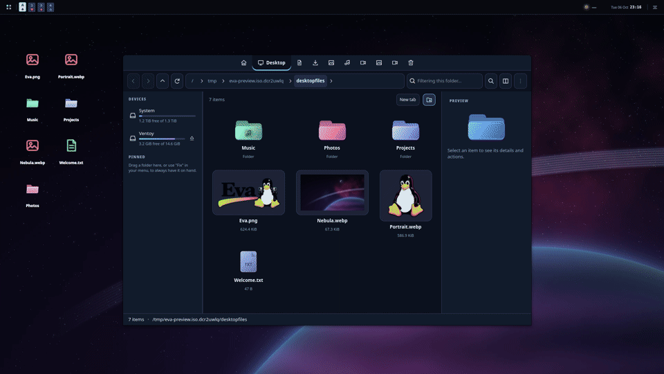 |


<details>
<summary>Play the application animation videos</summary>

**RGB glitch · Prisma opening**

https://github.com/user-attachments/assets/c9a0be91-fbf7-4670-ac9b-d6a901fe1269

**Lamp · Prisma closing**

https://github.com/user-attachments/assets/3f3e1602-7770-4390-9e48-c558f5cd5bcc

</details>

<a id="download"></a>

## Download and install

**[Open the Phase 1 download](https://github.com/2207juan/EVA/releases/tag/v0.1.0-phase1).** x86_64 · BIOS / UEFI.

1. Download these **four files** into the same folder:

   - [Eva-2026.10.06-x86_64.iso.part-001](https://github.com/2207juan/EVA/releases/download/v0.1.0-phase1/Eva-2026.10.06-x86_64.iso.part-001)
   - [Eva-2026.10.06-x86_64.iso.part-002](https://github.com/2207juan/EVA/releases/download/v0.1.0-phase1/Eva-2026.10.06-x86_64.iso.part-002)
   - [release.json](https://github.com/2207juan/EVA/releases/download/v0.1.0-phase1/release.json)
   - [reconstruir.py](https://github.com/2207juan/EVA/releases/download/v0.1.0-phase1/reconstruir.py)

2. Install [Python 3](https://www.python.org/downloads/) if needed. Open a terminal in that folder and run:

   ```sh
   python3 reconstruir.py --join release.json
   ```

   On Windows, use `python` instead of `python3`. The script verifies both parts and creates `Eva-2026.10.06-x86_64.iso`. **This is one ISO split into two downloads.**

3. Prepare a USB drive of **8 GB or more** with [Ventoy](https://www.ventoy.net/en/doc_start.html), then copy the reconstructed `.iso` onto it. Preparing the USB erases its contents. Windows users can also write the ISO with [Rufus](https://rufus.ie/en/).
4. Restart your computer, choose the USB in its boot menu, and select Eva. You can try the desktop before installing.
5. Open the Eva installer (Calamares). Choose your language, keyboard, installation disk and user account; review the summary before confirming. Back up your files first: erasing a disk deletes its contents.
6. When installation finishes, restart and remove the USB.

Game Center, Prisma, the dock, widgets and pets are included in Eva. Games and optional AI API keys are supplied separately. GitHub's **Source code (zip/tar.gz)** files contain this presentation, not the installation image.

> Phase 1 is a testing release. Back up your files before installing. Please report issues with your hardware, steps to reproduce and a screenshot without personal information.

## Updates

Eva keeps personal settings in your user profile. Eva package updates create local recovery snapshots before upgrading. Reinstalling or formatting a partition is a separate operation; keep a backup of your files.

[Report an issue](https://github.com/2207juan/EVA/issues) · [Follow us on social media](https://www.instagram.com/eva.frik)
