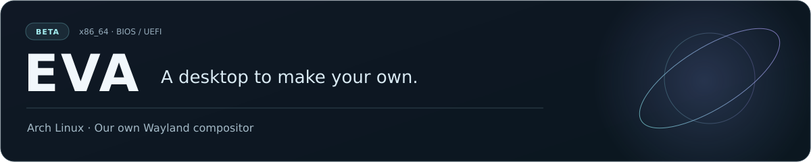
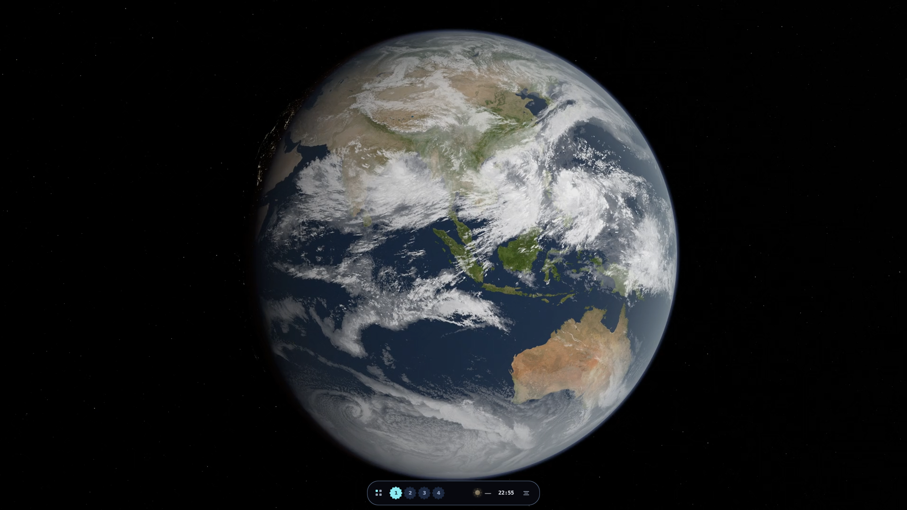
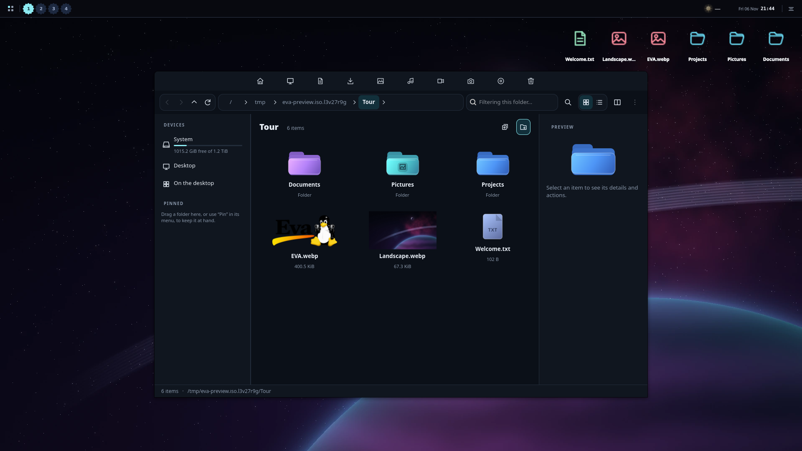
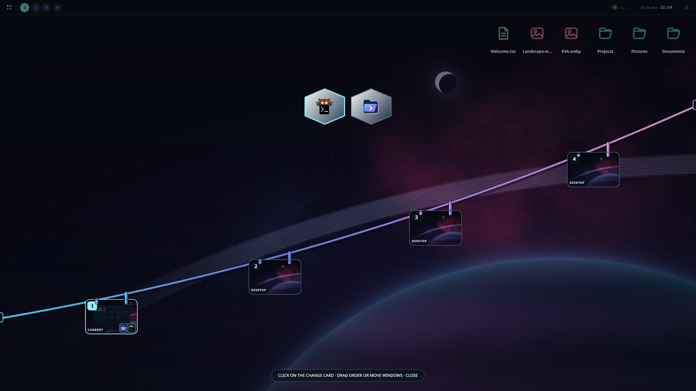
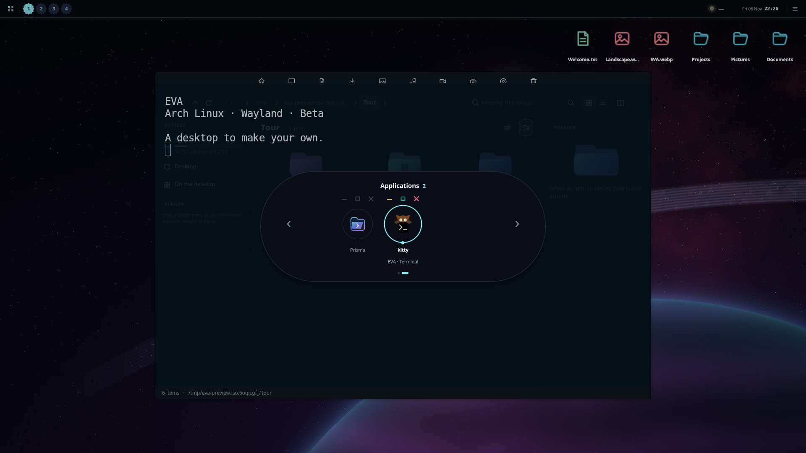
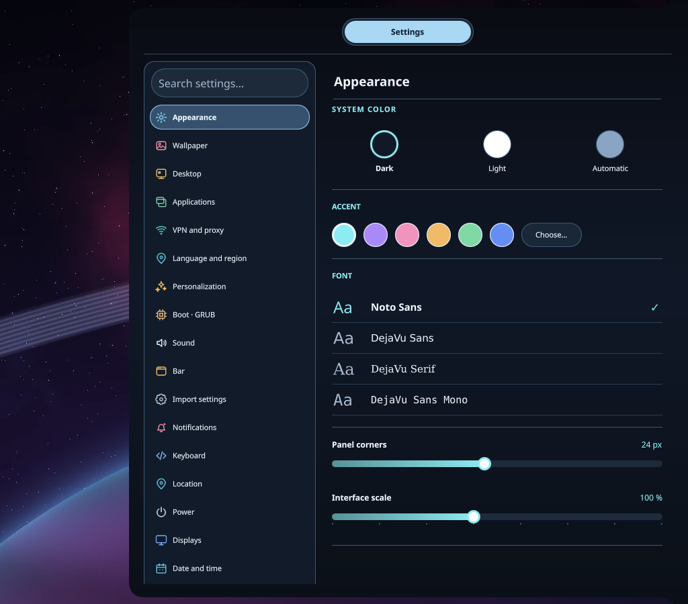
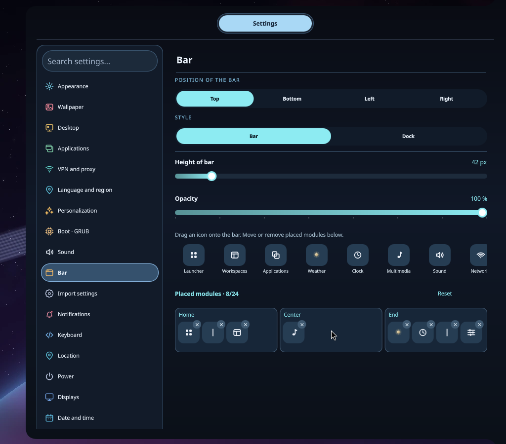
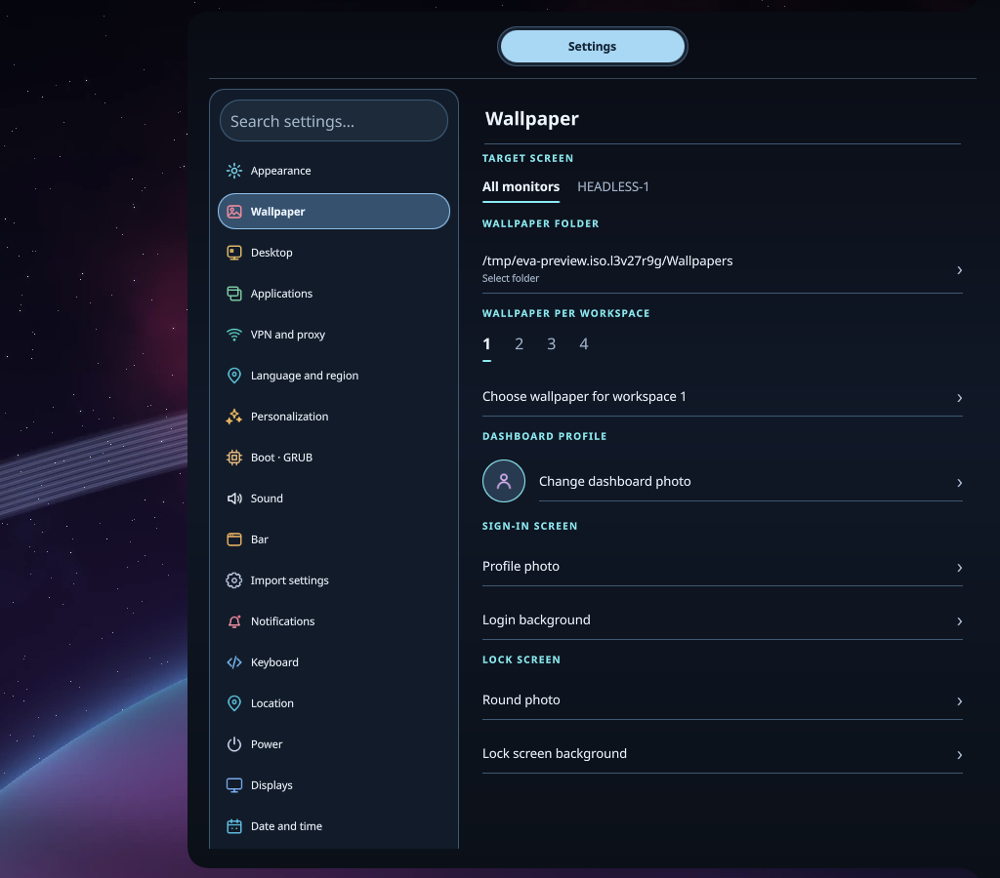
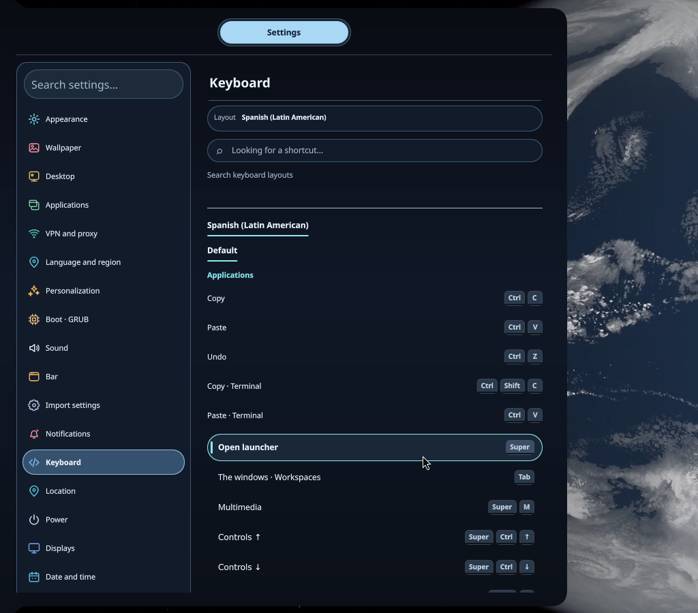

<b>English</b> · <a href="README.es.md">Español</a>

https://github.com/user-attachments/assets/66bce099-2a7d-4ea7-a75f-3814e7d73b33

<b>Current desktop tour · 3:29 · one continuous take</b>

https://github.com/user-attachments/assets/e9d5268e-ccf4-4f69-a276-cf3d2d52bf1d

English narration and desktop · Spanish subtitles.

EVA is an **Arch Linux** distribution with its own desktop and **Wayland compositor**. Window organization, personalization and everyday tools share one desktop interface.

**Currently in beta.** The available image is for **x86_64**, with BIOS/UEFI boot and a graphical installer. Screenshots and tours show current development; the linked ISO may be an earlier build.

## The desktop

A launcher that searches apps and local files, virtual desktops, tiled or floating windows, and **Prisma**, EVA's file manager. The application shelf brings open apps together without duplicating their icons in the dock.

<table>
<tr>
<td width="50%"> Desktop and dock</td>
<td width="50%"> Prisma · files and folders</td>
</tr>
<tr>
<td width="50%"> Tab · window overview</td>
<td width="50%"> Super+B · open applications</td>
</tr>
</table>

## Make it yours

Light or dark appearance, accent colors, backgrounds per workspace and monitor, a bar with draggable modules, and editable shortcuts. Available options adapt to the machine's hardware.

<table>
<tr>
<td width="50%"> Appearance · colors and effects</td>
<td width="50%"> Bar · modules and layout</td>
</tr>
<tr>
<td width="50%"> Wallpapers · workspaces and monitors</td>
<td width="50%"> Keyboard · layout and shortcuts</td>
</tr>
</table>

Screen capture, recording, local OCR, media controls, widgets and desktop pets are included. The AI island supports compatible providers and development agents; online AI features require your own service.

## Start here

| Action | Default shortcut |
| :-- | :-- |
| Launcher | `Super` |
| Window overview | `Tab` |
| Open applications | `Super+B` |
| Arrange windows | `Super+Z` |
| Prisma / wallpapers | `Super+P` / `Super+W` |
| Screenshot / recording | `Super+F` / `Super+G` |
| EVA AI | `Super+I` |

Super is the Windows key. Change shortcuts in **Settings → Keyboard**.

To try EVA, download the ISO, copy it to a Ventoy USB and boot from it. Open the graphical installer from the Live session. After installation, choose a boot theme in **Settings → Boot · GRUB**.

Continuous recordings of an EVA test session, with demonstration files and local synthetic narration. They do not show a physical installation or performance benchmarks. Back up your files before installing. The English tour includes Spanish subtitles.
