
<a href="https://github.com/2207juan/EVA/blob/main/docs/es/README.md">Español</a> &nbsp; / &nbsp; <a href="https://github.com/2207juan/EVA/blob/main/docs/en/README.md">English</a>

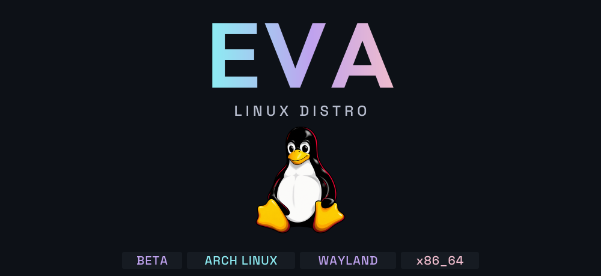

 

<b>BETA</b> &nbsp; · &nbsp; Intel / AMD x86_64 &nbsp; · &nbsp; Arch Linux &nbsp; · &nbsp; BIOS / UEFI

### See EVA in motion

https://github.com/user-attachments/assets/740f0eca-5151-4205-b564-433eeb7ee244

**1:27 · 60 FPS · One take, real speed.** English desktop and narration · Spanish subtitles.

Original EVA video

https://github.com/user-attachments/assets/66bce099-2a7d-4ea7-a75f-3814e7d73b33

EVA is an Arch Linux distribution built around its **own Wayland compositor and desktop**. Organize your work, shape the interface and keep everyday tools close. **Beta for x86_64 PCs and laptops.**

 

## 01 / Space for your ideas

**Prisma** for files and previews. **Tab** for the overview. **Super+B** for your open applications. **Snap** for layouts that fit the task.

<table>
<tr>
<td width="50%">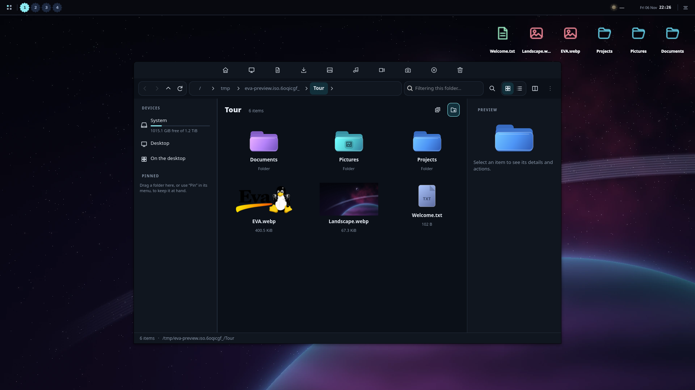 Prisma / files and previews</td>
<td width="50%">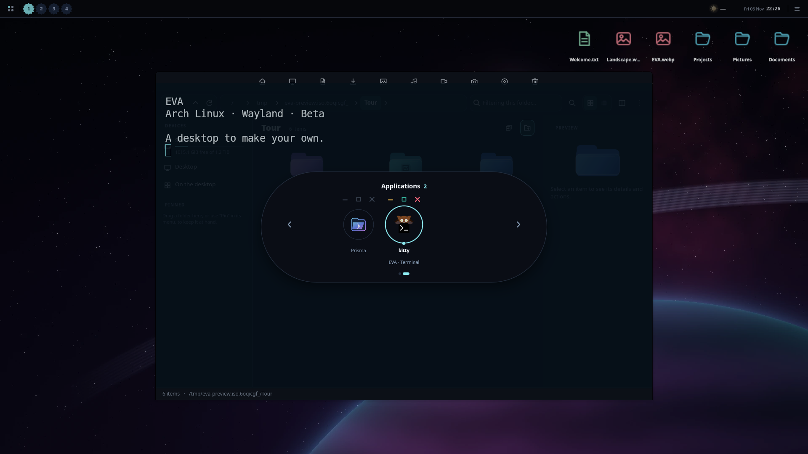 Application shelf / Super+B</td>
</tr>
<tr>
<td width="50%">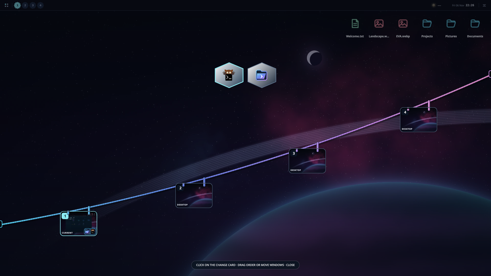 Window overview / Tab</td>
<td width="50%">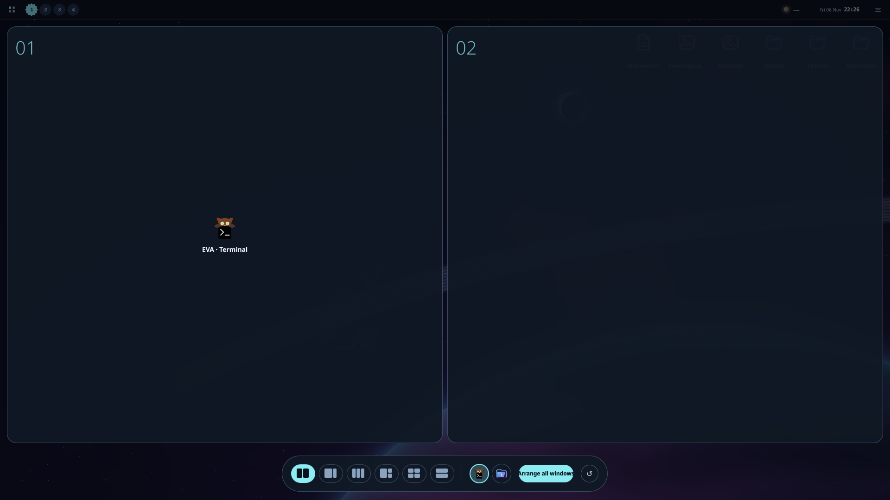 Snap / window layouts</td>
</tr>
</table>

## 02 / Change the mood

Static, animated and video backgrounds. A different look per workspace and monitor. Clocks, notes and more widgets, wherever you need them.

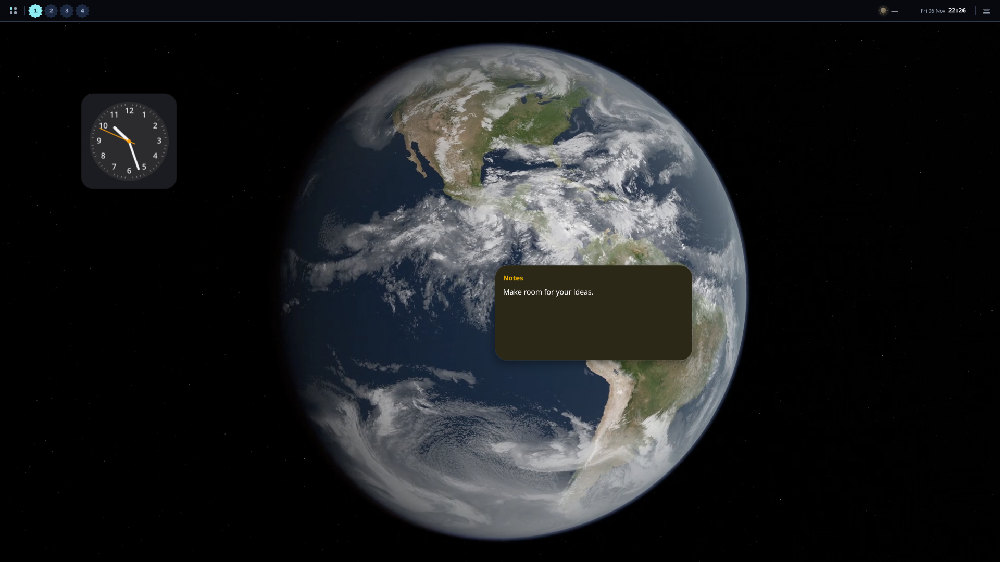

## 03 / Make every detail yours

<table>
<tr>
<td width="50%">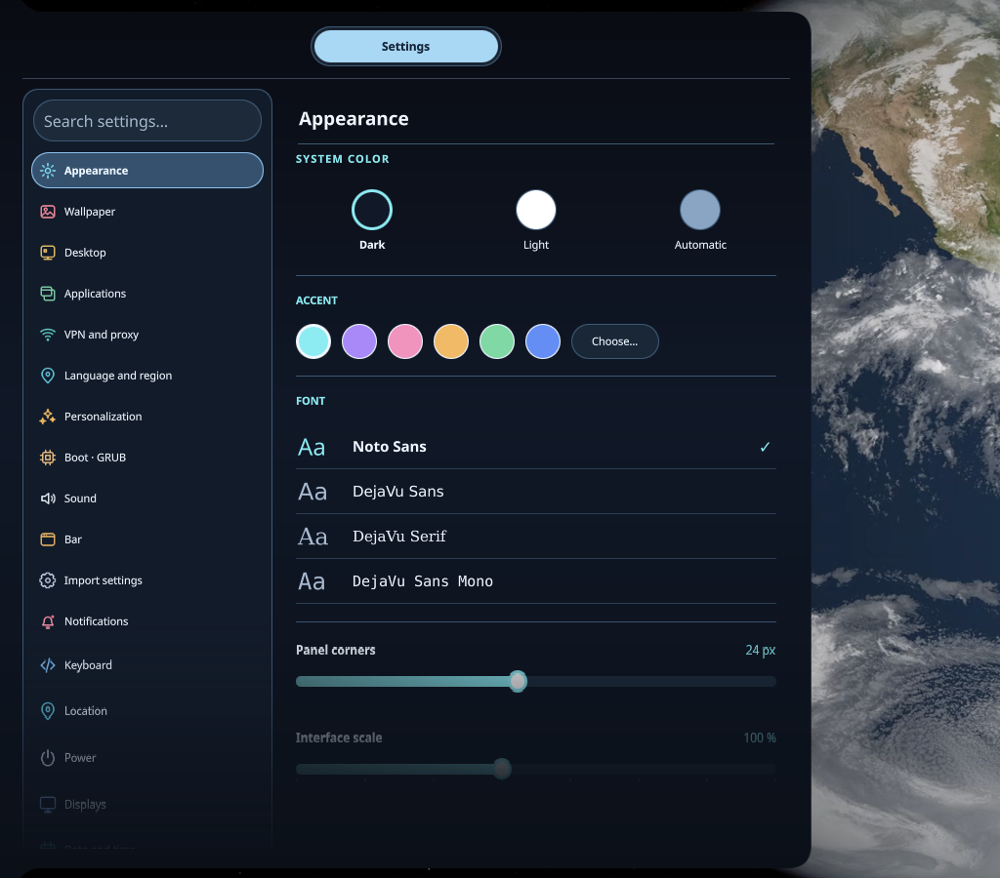 Appearance / light, dark and color</td>
<td width="50%">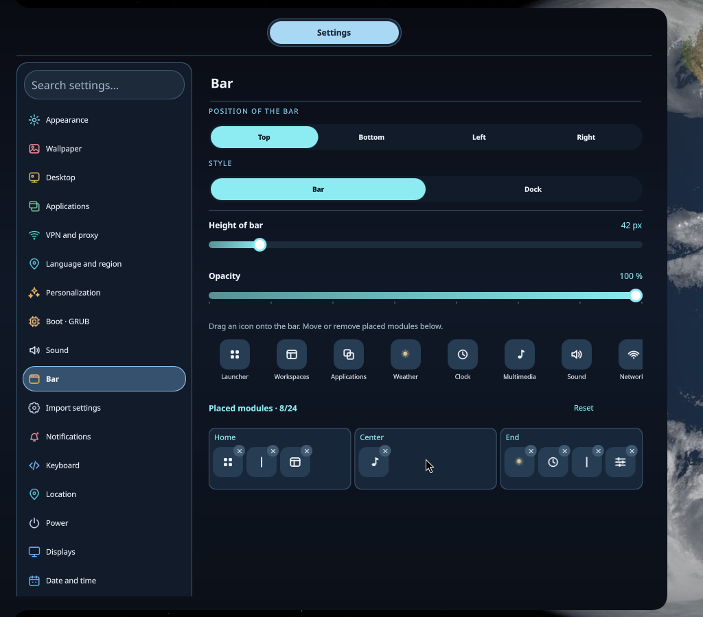 Bar / drag, arrange, remove</td>
</tr>
<tr>
<td width="50%">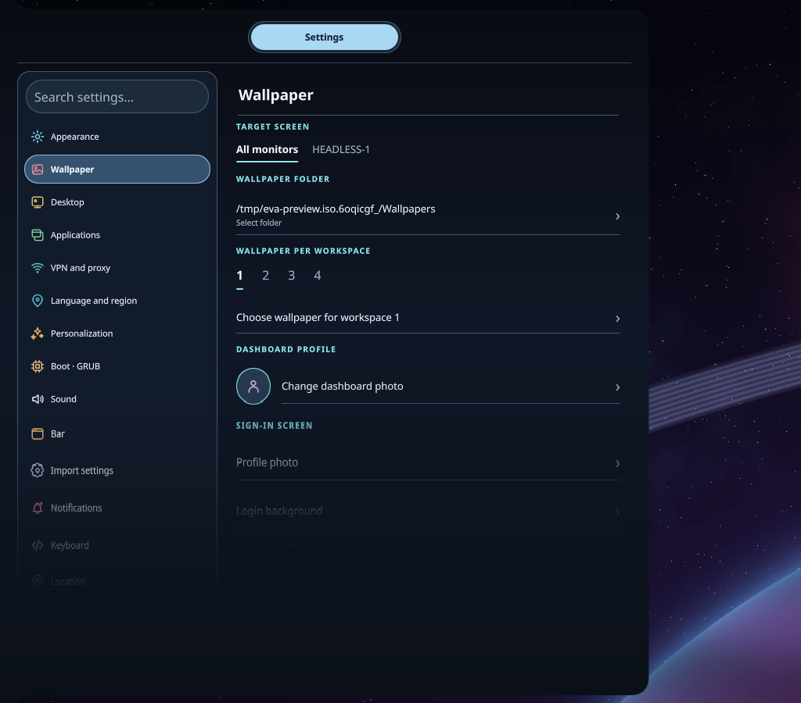 Wallpapers / workspace and monitor</td>
<td width="50%">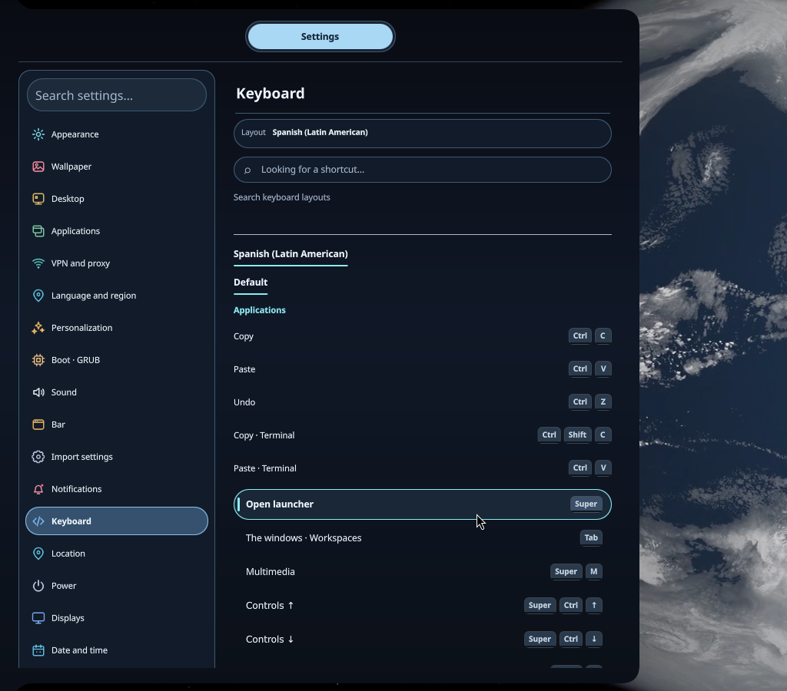 Keyboard / layout and shortcuts</td>
</tr>
</table>

## 04 / Time to play. Tools to create.

<table>
<tr>
<td width="50%">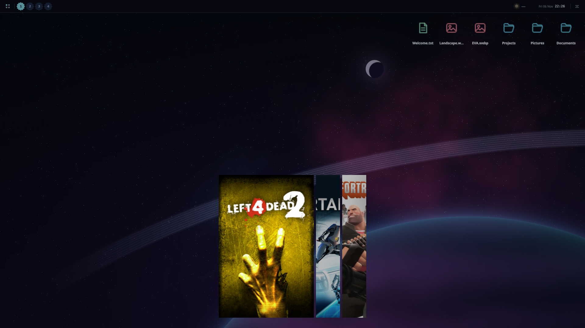 Game cover library / demonstration entries</td>
<td width="50%">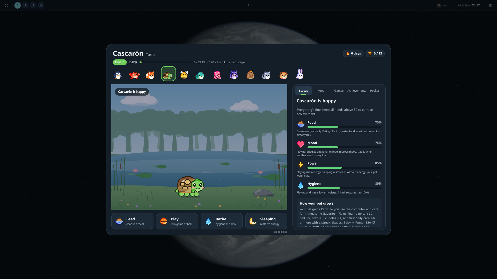 Desktop companions / local care</td>
</tr>
</table>

**Also inside:** media controls, system monitoring, screenshots, recording, local OCR, calendars, activities and an AI island for compatible services and development agents.

## 05 / Choose your next step

| Try EVA | Check your PC | Learn the controls |
| :-- | :-- | :-- |
| [Download the beta](https://drive.google.com/drive/folders/1uZRp9SGSDykXUKvbprnLntPWDCimsDnt?usp=sharing) · [Installation](https://github.com/2207juan/EVA/blob/main/docs/en/installation.md) | [CPU, graphics and requirements](https://github.com/2207juan/EVA/blob/main/docs/en/compatibility.md) | [Complete shortcut reference](https://github.com/2207juan/EVA/blob/main/docs/en/shortcuts.md) |

<a href="https://webdesing-40d1a.web.app/">Juan Pablo · Personal website</a> &nbsp; / &nbsp; <a href="https://github.com/2207juan/EVA/blob/main/docs/en/media.md">About the tour and credits</a>

Current development preview. The download may contain an earlier build.

