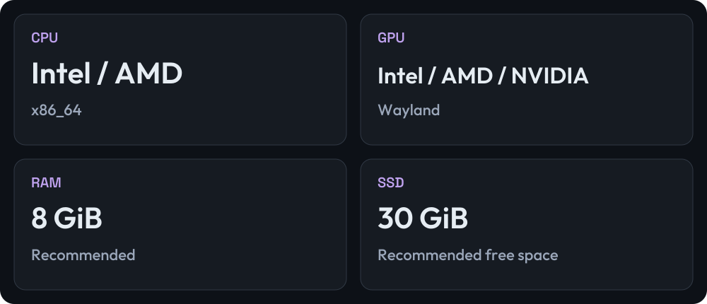

[← EVA](README.md) · [Español](../es/compatibility.md) / [English](../en/compatibility.md)

# Your PC

For 64-bit Intel and AMD desktops and laptops, with BIOS or UEFI boot and a graphics driver compatible with Wayland.

RAM and disk figures are recommendations for a first trial, not tested minima. Leave extra room for your files. EVA is in beta: try the Live USB before installing. ARM and Secure Boot have not been verified.
