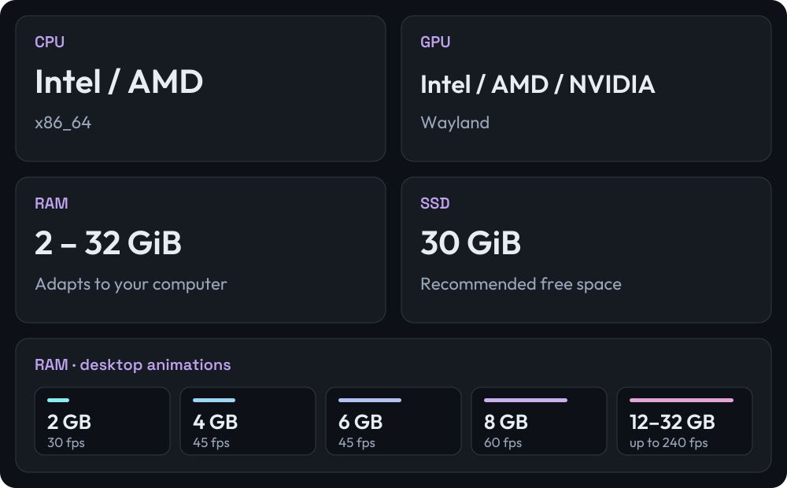

[← EVA](README.md) · [Español](../es/compatibility.md) / [English](../en/compatibility.md)

# Your PC

EVA runs on 64-bit Intel or AMD desktops and laptops, with BIOS or UEFI.

**One ISO for any amount of RAM.** At startup EVA checks your memory and CPU cores and tunes the animations by itself. There is nothing to pick, and no feature is removed.

| RAM | Animations |
| :-- | :-- |
| 2 GB | 30 fps |
| 4 – 6 GB | 45 fps |
| 8 GB or more | 60 fps |
| 12 – 32 GB, 8+ cores (desktop PC) | up to 240 fps |

With 4 cores or fewer, or on a laptop running on battery, EVA uses 45 fps to stay smooth and save power.

Try the Live USB before installing. ARM and Secure Boot have not been tested yet.

## ISO (32)

For older computers with a 32-bit-only processor (i686 with SSE2). It boots with BIOS or 32-bit UEFI and it is the same EVA, with its animations, widgets and apps.

- If your processor is 64-bit, use the regular ISO, even with little RAM.
- The first time you start an installed EVA, a menu helps you install the drivers for your PC.
- Automatic updates are not available in this edition yet.
