
<a href="https://github.com/2207juan/EVA/blob/main/docs/es/README.md">Español</a> &nbsp; / &nbsp; <a href="https://github.com/2207juan/EVA/blob/main/docs/en/README.md">English</a>

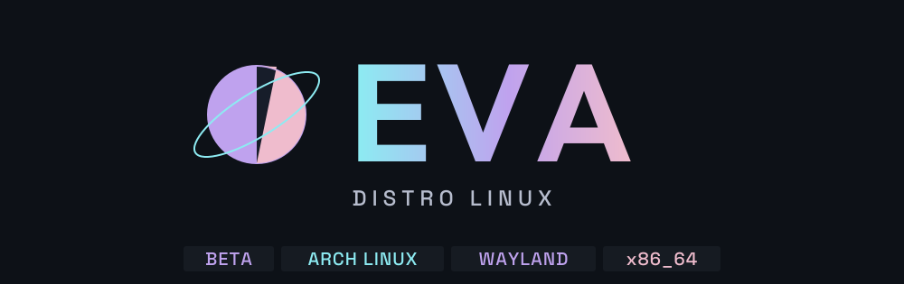

 

<b>BETA</b> &nbsp; · &nbsp; Intel / AMD x86_64 &nbsp; · &nbsp; Arch Linux &nbsp; · &nbsp; BIOS / UEFI

### Mira EVA en movimiento

https://github.com/user-attachments/assets/396e1ee9-1e2c-4071-80c0-358ce2023918

**1:42 · 60 FPS · Una toma a velocidad real.** Escritorio, voz y subtítulos en español.

Vídeo original de EVA

https://github.com/user-attachments/assets/66bce099-2a7d-4ea7-a75f-3814e7d73b33

EVA es una distribución Arch Linux con **compositor Wayland y escritorio propios**. Organiza tu trabajo, cambia la interfaz y ten a mano las herramientas del día a día. **Beta para PC y portátiles x86_64.**

 

## 01 / Espacio para tus ideas

**Prisma** para archivos y vistas previas. **Tab** para la vista general. **Super+B** para tus aplicaciones abiertas. **Snap** para organizar ventanas.

<table>
<tr>
<td width="50%">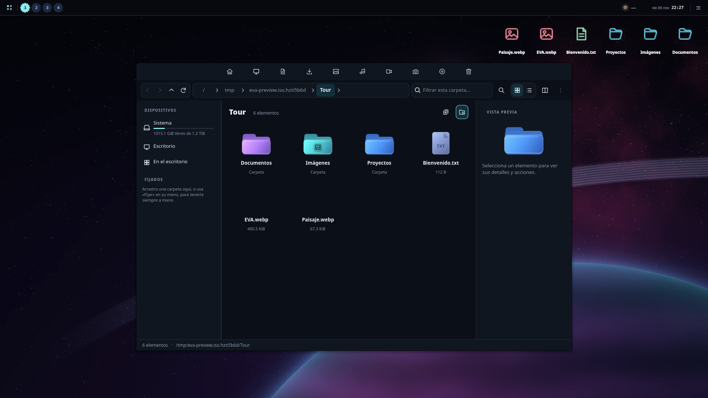 Prisma / archivos y vistas previas</td>
<td width="50%">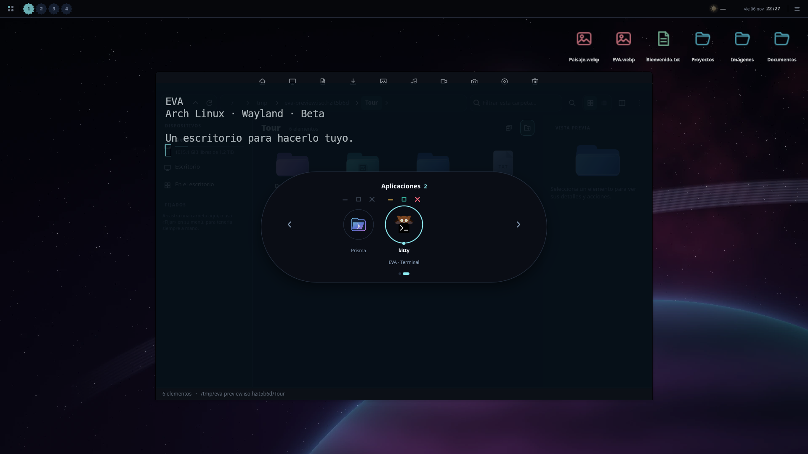 Estantería de aplicaciones / Super+B</td>
</tr>
<tr>
<td width="50%">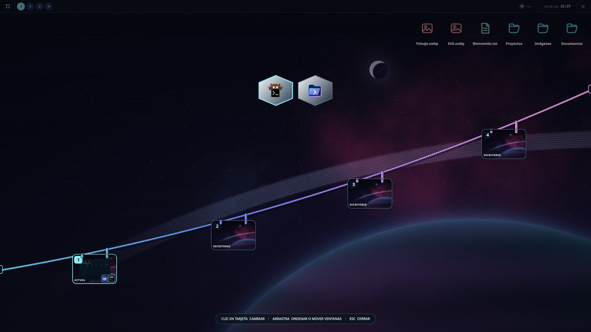 Vista general / Tab</td>
<td width="50%">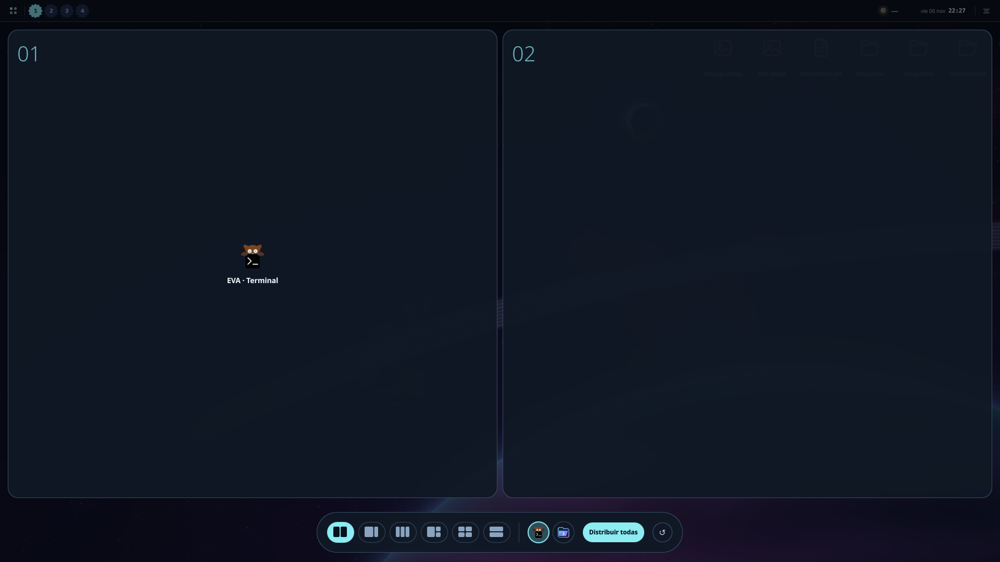 Snap / distribución de ventanas</td>
</tr>
</table>

## 02 / Cambia de ambiente

Fondos estáticos, animados y de vídeo. Un ambiente por escritorio y monitor. Relojes, notas y más widgets donde los necesites.

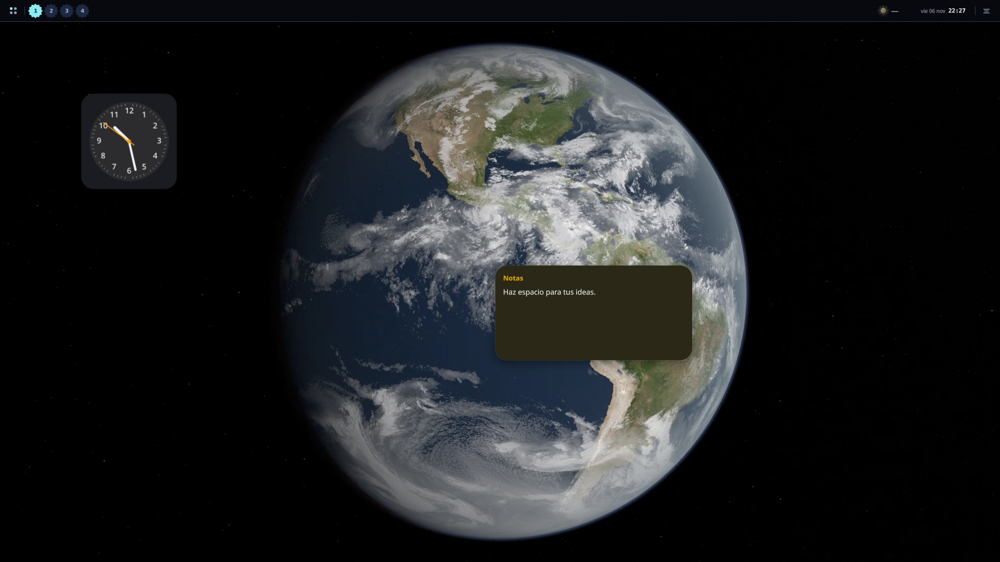

## 03 / Haz tuyo cada detalle

<table>
<tr>
<td width="50%">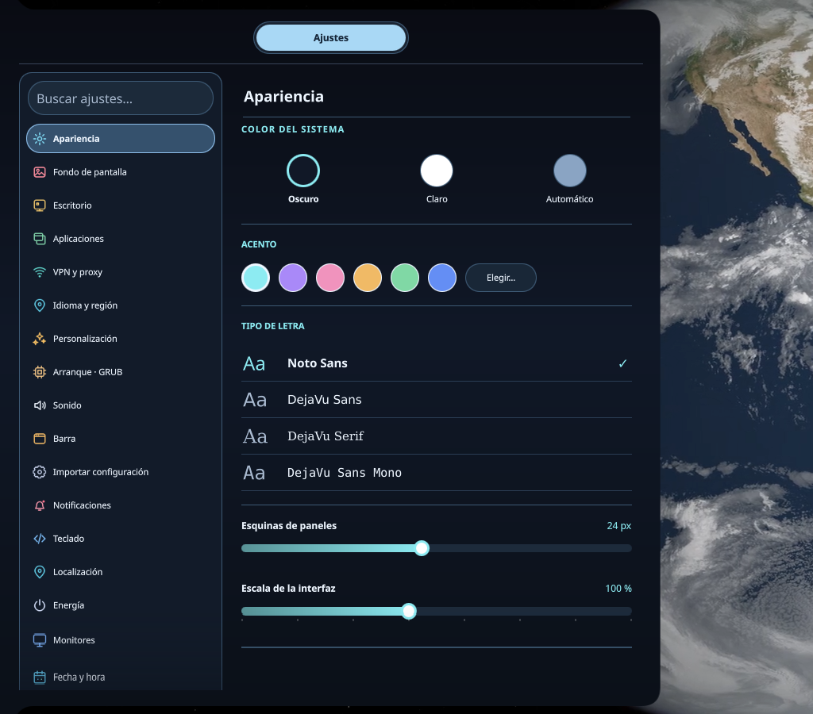 Apariencia / claro, oscuro y color</td>
<td width="50%">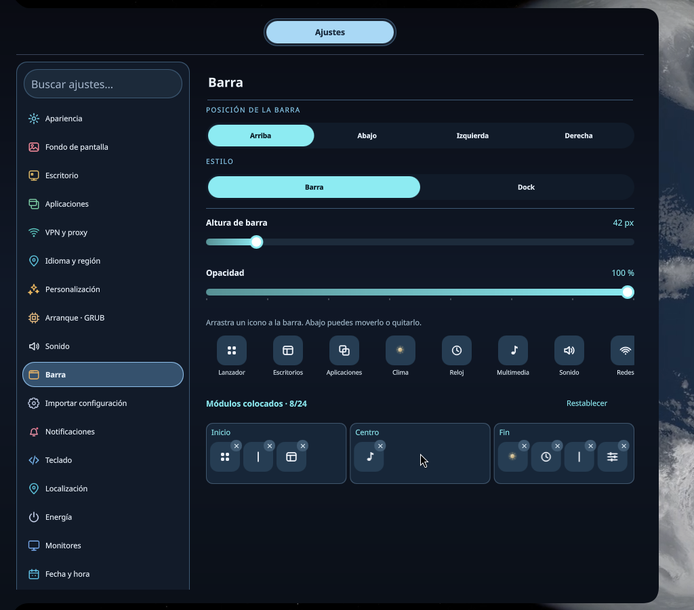 Barra / arrastra, acomoda y quita</td>
</tr>
<tr>
<td width="50%">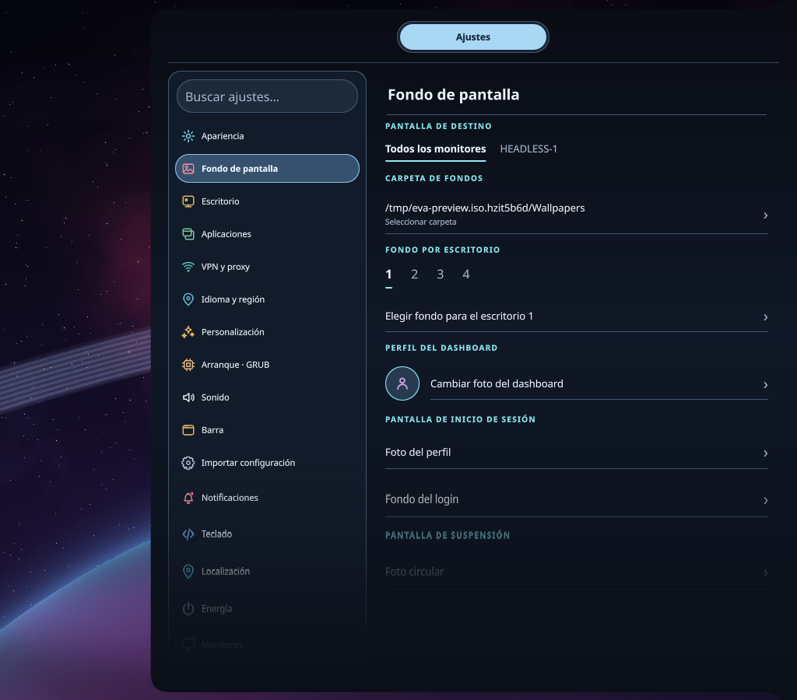 Fondos / escritorio y monitor</td>
<td width="50%">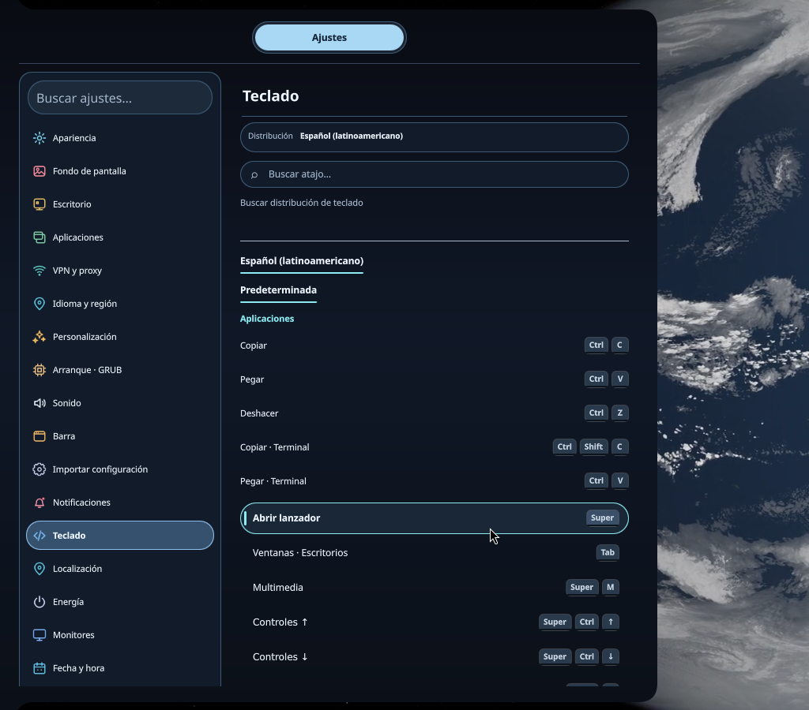 Teclado / distribución y atajos</td>
</tr>
</table>

## 04 / Juega. Crea. Explora.

<table>
<tr>
<td width="50%">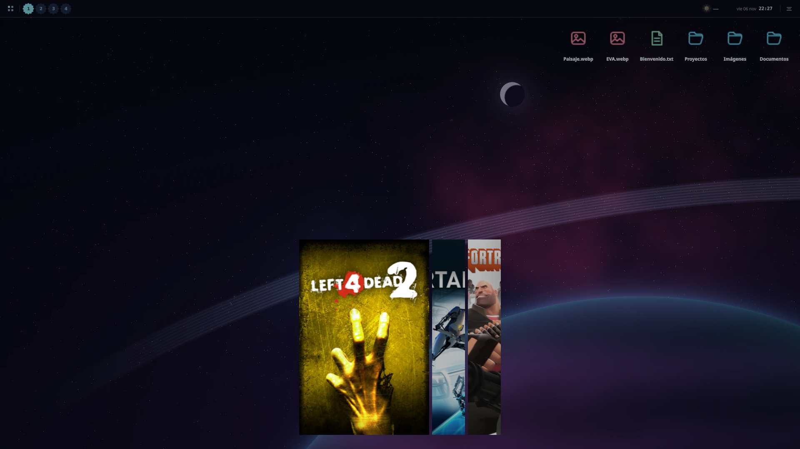 Biblioteca de carátulas / entradas de demostración</td>
<td width="50%">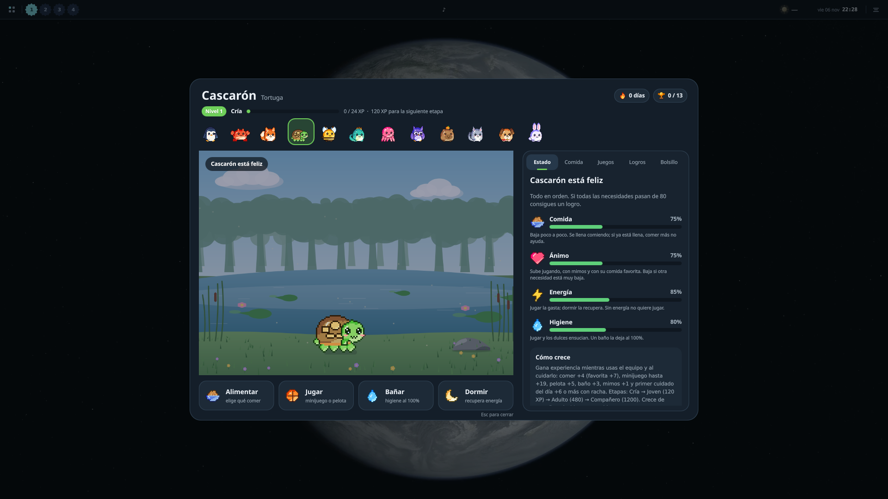 Mascotas / cuidado local</td>
</tr>
</table>

**También incluye:** multimedia, monitor del sistema, capturas, grabación, OCR local, calendario, actividades e isla de IA para servicios compatibles y agentes de desarrollo.

## 05 / Elige tu siguiente paso

| Probar EVA | Revisar tu PC | Conocer los controles |
| :-- | :-- | :-- |
| [Descargar la beta](https://drive.google.com/drive/folders/1uZRp9SGSDykXUKvbprnLntPWDCimsDnt?usp=sharing) · [Instalación](https://github.com/2207juan/EVA/blob/main/docs/es/installation.md) | [CPU, gráficos y requisitos](https://github.com/2207juan/EVA/blob/main/docs/es/compatibility.md) | [Referencia completa de atajos](https://github.com/2207juan/EVA/blob/main/docs/es/shortcuts.md) |

<a href="https://webdesing-40d1a.web.app/">Juan Pablo · Página personal</a> &nbsp; / &nbsp; <a href="https://github.com/2207juan/EVA/blob/main/docs/es/media.md">Sobre el recorrido y créditos</a>

Vista del desarrollo actual. La descarga puede contener una compilación anterior.

