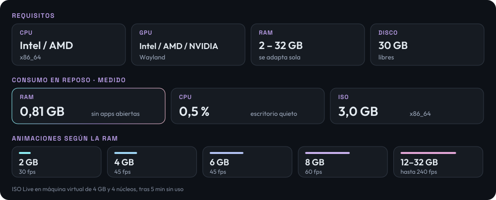

[← EVA](README.md) · [Español](../es/compatibility.md) / [English](../en/compatibility.md)

# Tu PC

EVA funciona en PC y portátiles Intel o AMD de 64 bits, con BIOS o UEFI.

**Una sola ISO para cualquier cantidad de RAM.** Al arrancar, EVA mira la memoria y los núcleos de tu equipo y ajusta las animaciones sola. No tienes que elegir nada y no se pierde ninguna función.

| RAM | Animaciones |
| :-- | :-- |
| 2 GB | 30 fps |
| 4 – 6 GB | 45 fps |
| 8 GB o más | 60 fps |
| 12 – 32 GB, 8 núcleos o más (PC de escritorio) | hasta 240 fps |

Con 4 núcleos o menos, o en un portátil con batería, EVA usa 45 fps para ir fluida y ahorrar energía.

Antes de instalar, prueba el USB Live. Todavía no se ha probado en ARM ni con Secure Boot.

## ISO (32)

Para equipos antiguos con procesador de solo 32 bits (i686 con SSE2). Arranca con BIOS o UEFI de 32 bits y es la misma EVA, con sus animaciones, widgets y aplicaciones.

- Si tu procesador es de 64 bits, usa la ISO normal, aunque tengas poca RAM.
- La primera vez que inicias EVA instalada, un menú te ayuda a instalar los controladores de tu PC.
- Las actualizaciones automáticas todavía no están disponibles en esta edición.
