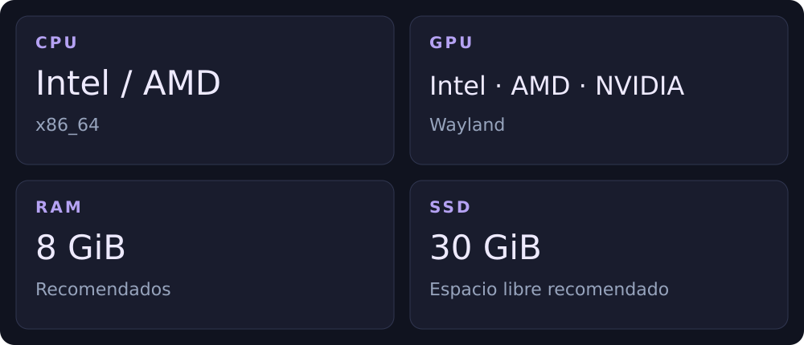

[← EVA](README.md) · [Español](../es/compatibility.md) / [English](../en/compatibility.md)

# Tu PC

Para PC y portátiles Intel y AMD de 64 bits, con arranque BIOS o UEFI y un controlador gráfico compatible con Wayland.

Las cifras de RAM y disco son recomendaciones para una primera prueba, no mínimos medidos. Deja espacio adicional para tus archivos. EVA está en beta: prueba el USB Live antes de instalar. ARM y Secure Boot no están verificados.
